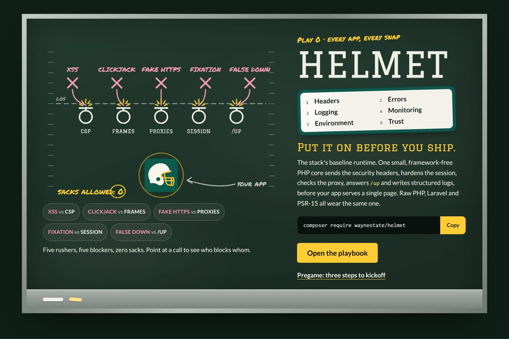
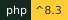
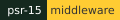
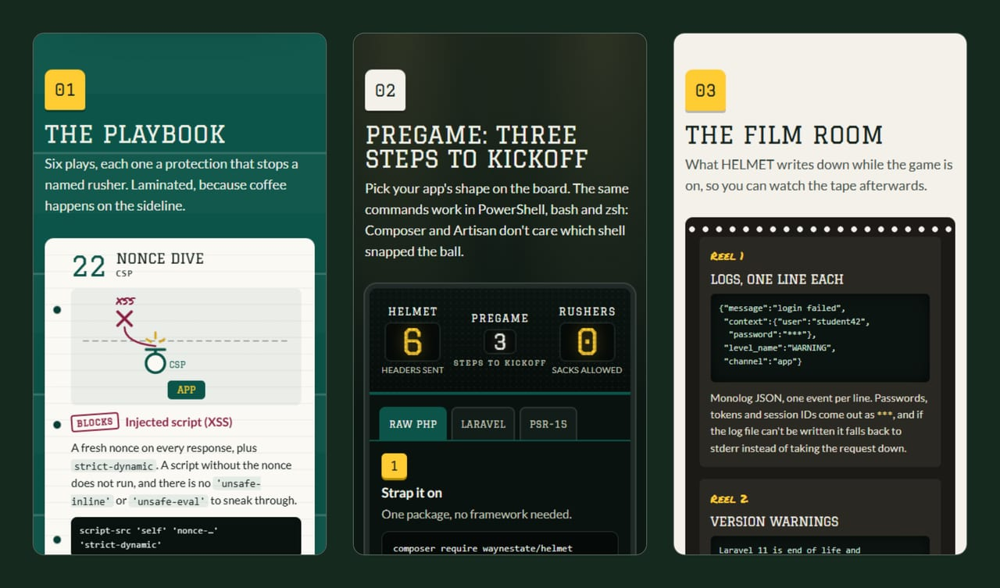
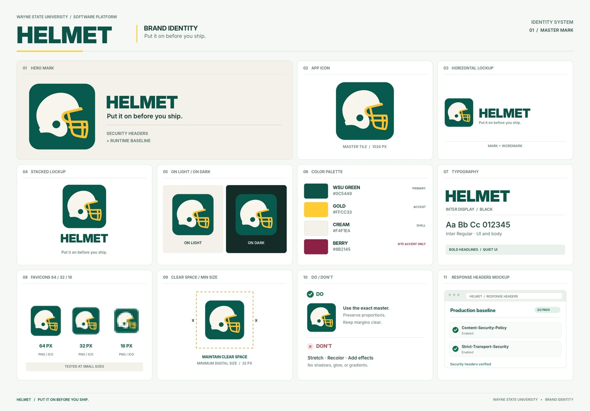

<div align="center">
  <a href="site/index.html"></a>
</div>

# HELMET


<sub>GIF via [Tenor](https://tenor.com/view/helmet-band-wilmas-rainbow-helmet-band-music-gif-25658120)</sub>

<p>
  
  
  
  <a href="https://github.com/waynestate/helmet/actions/workflows/ci.yml"></a>
</p>

**Put it on before you ship.** Security headers, a hardened session and an honest proxy check, snapped on before
the first page is served.

Checks: `composer ci` (the same command runs on GitLab and GitHub).
Two mirrors, one command: the only thing in this repo that plays both sides is the CI.
Front page: [`site/index.html`](site/index.html), the playbook, as static files ([`site/README.md`](site/README.md)).
On Citadel it is served by the raw-PHP deploy layer in [`deploy/`](deploy/): a Squire kit whose front controller serves `site/` behind HELMET's security headers. For local development, keep serving `site/` directly.
Documentation: [helmet.apps.wayne.edu/docs/](https://helmet.apps.wayne.edu/docs/) carries the overview, the install and quick start, a guide per topic (headers, CSP, HSTS, session, proxies, the request-forgery guard, readiness, metrics, platforms), the API and environment variable reference, troubleshooting and upgrading.

HELMET is the Wayne State app stack's baseline runtime. One small
framework-free PHP core, `Waynestate\Helmet`, does the five things every app on
Citadel needs before it serves a single page: it sends the security headers,
hardens the session, decides whether the request really arrived over HTTPS,
answers the load balancer's `/up` ping, and writes structured logs.

## Where the code lives

The canonical repository is [git.wayne.edu/enterprise-apps/helmet](https://git.wayne.edu/enterprise-apps/helmet) (clone over SSH as `git@git.wayne.edu:enterprise-apps/helmet.git`, or HTTPS as `https://git.wayne.edu/enterprise-apps/helmet.git`). Open issues and merge requests there; tags are made there, by the maintainer, with an approver.
GitHub ([waynestate/helmet](https://github.com/waynestate/helmet)) is a read-only push mirror of it. Nobody pushes to the mirror; Packagist reads from it.
git.wayne.edu is the head this helmet fits; the mirror is the mannequin.

It is the floor, not the ceiling. An app on raw PHP calls `helmet_boot()` once
at the top of its front controller and is done. An app on Laravel or a PSR-15
stack mounts the same core as middleware and gets the identical headers. The
rules live in one place, and every consumer path agrees.

## Install

```
composer require waynestate/helmet
```

Composer picks the latest release, 1.4.1, and writes `^1.4` into `composer.json`. From 1.0 HELMET
follows semantic versioning; [Upgrading](docs/upgrading.md) has what changed since 0.4, starting with the one that
bites: an unknown quoted CSP source now throws at boot.

<details>
<summary><b>Walk the sideline</b>: the front page's playbook, pregame and film room</summary>
<br>
<div align="center"></div>
</details>

## Platform presets

A preset names a platform's trusted-proxy list, so an app does not hard-code
an address that belongs to the platform, not the app. The presets live in
`Waynestate\Helmet\Platform\Presets`:

| Preset | Trusted proxies |
| --- | --- |
| `citadel` | the Docker bridge gateway to the HA-Proxy front (see "Running off Citadel") |
| `docker` | none: a plain Docker network with no front proxy |

Raw PHP passes the preset name in the `preset` option:

```php
$helmet = helmet_boot([
    'preset' => 'citadel',
]);
```

Laravel reads it from `HELMET_PRESET` (see the environment table below;
Playbook supplies it when the environment has none); an explicit
`HELMET_PROXIES` always wins over the preset.

Off the WSU platform, skip the preset and pass your own list of the addresses
your front proxy connects from:

```php
$helmet = helmet_boot([
    'trusted_proxies' => ['203.0.113.10'],
]);
```

An unknown preset name throws at boot, so a typo fails loudly instead of
silently trusting nothing.

## WSU values (Playbook)

The Laravel config reads `HELMET_PRESET` from the environment first and from
the private `waynestate/playbook` package (Playbook) second, when the
environment has no value. The raw PHP path takes the preset as an option to
`helmet_boot()` and reads no environment at all.

| Setting | What it is |
| --- | --- |
| `HELMET_PRESET` | A platform preset name (`citadel` or `docker`) that supplies the trusted proxies. |

Get Playbook with your own GitLab token, three ways.

Composer: add the repository to your app's `composer.json`, put the token in
`auth.json` (Composer's credential store, never in the repo), then require
the package:

```json
{
    "repositories": [
        {
            "type": "vcs",
            "url": "https://git.wayne.edu/enterprise-apps/playbook.git"
        }
    ]
}
```

```
composer require waynestate/playbook
```

Or fetch the values file directly.

curl (Linux, macOS):

```
curl --fail -H "PRIVATE-TOKEN: $GITLAB_TOKEN" "https://git.wayne.edu/api/v4/projects/enterprise-apps%2Fplaybook/repository/files/playbook.env/raw?ref=main" -o .env.playbook
```

PowerShell (Windows):

```
Invoke-WebRequest -Headers @{ 'PRIVATE-TOKEN' = $env:GITLAB_TOKEN } -Uri "https://git.wayne.edu/api/v4/projects/enterprise-apps%2Fplaybook/repository/files/playbook.env/raw?ref=main" -OutFile .env.playbook
```

Clone:

```
git clone https://git.wayne.edu/enterprise-apps/playbook.git
```

A fetched `.env.playbook` is plain `KEY=value` lines: copy the ones you need
into your app's `.env` (or your Citadel environment).

The token is your own: `read_api` for curl, `read_repository` for clone and
Composer.

Playbook is private on git.wayne.edu. If you get a 404, ask the Enterprise
Applications team for read access.

## Running off Citadel

HELMET ships one package for every platform, so running off Citadel means
changing configuration, not code. The only platform fact it needs is the
address of whatever stands in front of the app container:

| Platform | What sits in front | `HELMET_PROXIES` | Where logs go |
| --- | --- | --- | --- |
| Citadel | HA-Proxy | use the `citadel` preset (`172.18.0.1`) | a file you set, such as `/var/log/app/helmet.log` (the preset sets proxies only) |
| OpenShift | the OpenShift router | the router's pod network CIDR, from your cluster admin | `php://stderr` |
| Coolify | Traefik or Caddy | the Docker network of the proxy | `php://stderr` |
| Raw Docker behind a compose proxy | your proxy service | the compose network's subnet | `php://stderr` |

One caveat about the `citadel` row: `172.18.0.1` is the Docker bridge
gateway, and the `citadel` preset is safe only when the front proxy
reaches the app over that bridge. A published app port that is
source-NATed to the gateway address would make a direct client look like
the proxy, so the platform must not publish the app's port.

An explicit `HELMET_PROXIES` overrides the preset on every platform. With
neither a preset nor a list, no address is trusted, so forwarded headers
such as `X-Forwarded-Proto` are ignored and the request is read as it arrived. Off Citadel, log to `php://stderr` and
let the container runtime collect the lines.

The helmet comes off the platform, not the app.

## Usage

### Raw PHP

At the top of the front controller, before anything is echoed:

```php
use function Waynestate\Helmet\helmet_boot;

$helmet = helmet_boot([
    // The platform preset that supplies the trusted proxies. An explicit
    // 'trusted_proxies' list wins over the preset.
    'preset' => 'citadel',

    // Optional. A Monolog JSON logger, one line per record. "stream" may be a
    // stream or a file path. The presets supply trusted proxies only, so the
    // app picks its own log stream: on a platform like Citadel a file such as
    // /var/log/app/helmet.log, off the platform php://stderr. Every record
    // carries a request ID in extra.request_id, generated by HELMET; an
    // inbound header is never trusted for it. Set "request_id" to reuse an ID
    // you already have (8 to 64 letters, digits, dots, underscores or dashes).
    'log' => [
        'channel' => 'app',
        'stream'  => 'php://stderr',
        'level'   => 'info',
        // 'request_id' => 'req-20261029-abcd',
    ],
]);

// $helmet['nonce'] is the per-request CSP nonce. Put it in your <script> tags.
// $helmet['logger'] is a Psr\Log\LoggerInterface, or null when no log is set.
// $helmet['request_id'] is the ID stamped on this process's log records.
```

Every other `helmet_boot()` option is covered in its own section below:
`csp` and `style_src_attr` (Customizing the CSP), `csp_report_uri` and `csp_report_only`
(CSP reports), `coop`, `corp`, `coep` and `permissions_policy` (Cross-origin
isolation and feature policy), `hsts_max_age`, `hsts_include_subdomains`
and `hsts_preload` (Configuring HSTS), `no_store` (the no-store rows of
[Raw PHP and Laravel agree](#raw-php-and-laravel-agree)), `csrf`
(The request-forgery guard), `health_path` (Health check without a front
controller), `readiness` (Readiness is a separate check), `session` (The session, secure mode) and `error_handler`
(A generic error page).

The `log` option configures that logger: `channel` names it, `stream` is a
stream or a file path, and `level` sets the minimum level. Set `request_id`
to reuse an ID you already have (8 to 64 letters, digits, dots, underscores
or dashes); otherwise HELMET generates one for the process.

Each record is one JSON line:

```json
{"message":"login","context":{"user":"alice"},"level":200,"level_name":"INFO","channel":"app","datetime":"2026-10-29T12:00:00.000000+00:00","extra":{"request_id":"9f2c1ab04d5e6f70"}}
```

#### Security events

Five warnings carry HELMET's security events, and a logger that throws never
changes the answer: the `403` still goes out, the resolved client IP is still
the peer, the HTTPS decision stands, and the boot still finishes.

| Message | When | Context keys |
| --- | --- | --- |
| `helmet.request_refused` | the request-forgery guard answers `403` | `event` (`request_refused`), `method` (upper case), `path` (no query string), `sec_fetch_site` (`same-origin`, `same-site`, `cross-site`, `none`, `other`, or null when the header is absent), `origin_present` (bool) |
| `helmet.forwarded_for_rejected` | `ClientIp::resolve()` fails closed on an unparseable `X-Forwarded-For` entry: in `helmet_metrics()` and in the Laravel metrics endpoint | `event` (`forwarded_for_rejected`), `reason` (`unparseable_entry`), `peer` (the trusted peer address) |
| `helmet.forwarded_proto_rejected` | the HTTPS check sees `X-Forwarded-Proto` from a peer that is not a trusted proxy, and ignores it: in `helmet_boot()`, `SecurityHeadersMiddleware` and the Laravel `SecurityHeaders` middleware | `event` (`forwarded_proto_rejected`), `reason` (`untrusted_peer`), `peer` (the untrusted peer address) |
| `helmet.debug_enabled_in_production` | the Laravel adapter boots with `app.debug` true in the production environment | `event` (`debug_enabled_in_production`) |
| `helmet.broad_trusted_proxy` | the app boots with a broad entry in its trusted-proxy list (an IPv4 range shorter than `/16` or an IPv6 range shorter than `/48`) | `event` (`broad_trusted_proxy`), `entries` (the broad entries, as configured) |

Never logged: the Origin value, cookies, Authorization, the `X-Forwarded-For`
or `X-Forwarded-Proto` header, or the bad entry. The helmet takes the hit and
reports it, without quoting the attacker.

The logger reaches each path this way: `helmet_boot()` hands its own logger to
the HTTPS check and the guard; PSR-15 users pass a `LoggerInterface` as the
last constructor argument `$logger` of `SecurityHeadersMiddleware` and of
`RequestForgeryGuard` (both default to `null`, which logs nothing);
`helmet_metrics()` passes its configured logger to `ClientIp::resolve()`; the
Laravel adapter writes every event through the app's own logger.

Use a platform preset (for example `citadel`, which trusts the Docker bridge
gateway), or list only the address the front proxy connects from, never a
whole private range. A broad range such as `10.0.0.0/8` also trusts other
containers on the same network, and any of them could then set
`X-Forwarded-Proto`. When the list does hold a broad entry, an IPv4 range
shorter than `/16` or an IPv6 range shorter than `/48`, `helmet_boot()` writes
one `helmet.broad_trusted_proxy` warning through the configured logger; set
`warn_broad_proxies` to `false` to silence it. An explicitly empty
`HELMET_PROXIES` means trust nobody, even when a preset is set; only an unset
variable falls back to the preset.

The `citadel` preset trusts the container bridge gateway address, which is
only correct while the app's port is not published to the host network,
because a published port can make a direct client appear to come from the
gateway.

`helmet_boot()` sends the headers, strips `X-Powered-By`, and answers `/up`
with `200 ok` before your code runs. It returns the nonce, the logger and
the request ID so the rest of the app can use them.

#### A generic error page

A raw PHP app has no framework to catch an uncaught exception, so PHP may print
the message, the file path and a stack trace to the visitor. Turn on the
opt-in `error_handler` and the visitor gets a short, fixed "Something went wrong"
page with status 500 and `Cache-Control: no-store`, while the full detail
(class, message, file, line and trace) goes to the log at `error` level:

```php
helmet_boot([
    'error_handler' => ['enabled' => true],
]);
```

The page never contains anything from the exception, and a logger that
throws cannot change it. It is off by default, and Laravel keeps its own
exception handler. If you want to build the page yourself, call
`(new \Waynestate\Helmet\Error\GenericErrorResponse())->build($exception, $logger)`
for the status, headers and body as data. HELMET does not switch PHP's
`display_errors` off for you; the platform setting does that.

The same class builds the 4xx half of the rule. A raw PHP router answers a
client fault with `helmet_client_error()`, which sends the status, the fixed
page and `Cache-Control: no-store`, then exits:

```php
use function Waynestate\Helmet\helmet_client_error;

if ($route === null) {
    helmet_client_error(404);
}
```

`helmet_client_error_response($status)` returns the same answer as data
(status, headers, body) when you want to send it yourself, and
`(new \Waynestate\Helmet\Error\GenericErrorResponse())->clientError($status)`
is the class underneath both. The page is fixed text: 400, 401, 403, 404,
405, 410 and 429 each carry their own title and sentence, and any other 4xx
keeps the status you passed and falls back to the Bad request text. Nothing
from the request or an exception reaches the body. Only 400 to 499 is
accepted: a 500 or a redirect status throws `\InvalidArgumentException`
before anything is sent. In Laravel, `HELMET_ERROR_PAGES=true` does the same
for every 4xx HTTP exception (see the Laravel environment variables below).

#### Debug output stays off in production

HELMET never switches debug output off or on for you, because the right place is
the platform, not a library. Two settings decide whether a visitor can read a
stack trace, and both belong to your deploy:

- **PHP's `display_errors`.** Keep it `Off` in production. Squire's deploy kit
  already ships a `php.ini` with `display_errors = Off` and `log_errors = On`
  (`deploy/.squire/php.ini` in a Squire-based app), and Citadel uses the same
  values. Off the platform, set it in `php.ini` or the FPM pool. HELMET does not
  set or check it.
- **Laravel's `APP_DEBUG`.** Keep it `false` in production. The Laravel adapter
  cannot stop an app from turning it on, but it notices: when the app boots with
  `app.debug` true in the production environment it writes one warning,
  `helmet.debug_enabled_in_production`, through the Log facade. Opt out with
  `helmet.warn_debug` (env `HELMET_WARN_DEBUG`, default `true`). A logger that
  fails never breaks the boot.

The opt-in error handler above covers one more case: with it on, an uncaught
exception in a raw PHP app shows the fixed 500 page even if `display_errors` is
wrong. Warnings and notices still follow `display_errors`, so set it anyway.

#### Health check without a front controller

A raw PHP app with no front controller (or an Apache setup with no rewrite)
never reaches `helmet_boot()` for `/up`. Ship a two-line `public/up.php`
that calls HELMET directly:

```php
<?php // public/up.php
use function Waynestate\Helmet\helmet_up;

require __DIR__ . '/../vendor/autoload.php';
helmet_up();
```

Squire's raw template ships this file. The probe only checks that the ball
is in the air; it does not grade the play.

#### Readiness is a separate check

`/up` is liveness: "the process is running". Keep it free of dependency checks. If `/up` fails because the database is
down, the platform restarts a healthy app and makes the outage worse. Readiness is the other question, "send me
traffic?", and HELMET answers it on its own path, `/ready`, off unless you turn it on:

```php
$helmet = helmet_boot([
    'preset' => 'citadel',
    'readiness' => [
        'enabled' => true,                       // default false
        'path' => '/ready',                      // the default; must differ from health_path
        'checks' => [
            'database' => static fn (): bool => db_ping(), // true or null passes, false fails
        ],
    ],
]);
```

The answer is JSON, `no-store`, 200 while no check failed and 503 once one did:

```json
{"status":"ready","checks":{"headers":{"status":"pass","csp":"enforce","style_src_attr":"inline"},"trusted_proxies":{"status":"pass","count":1,"broad":0},"debug_output":{"status":"pass"},"database":{"status":"pass"}}}
```

HELMET adds three checks of its own config: the header set builds and carries a CSP (and in which mode), how many
trusted proxies there are and how many are broad (a count, never an address), and whether `display_errors` is on. The
last two warn and never fail. A check that throws fails, and its message goes to the log
(`helmet.readiness_check_failed`), never the body. Give your checks a short timeout so a hung database cannot hang the
probe. No secrets, no addresses, no policy text: the probe is reachable by anyone who can reach the app.

A raw app with no front controller can answer from `public/ready.php` with `helmet_ready()`; PSR-15 apps add the
`ReadinessCheck` middleware; Laravel apps call `Route::helmetReady()`. Never point the restart (liveness) probe at
`/ready`, and in Laravel do not put dependency checks in the `DiagnosingHealth` listener, because that event fires for
`/up`. Where each platform wants which path (Citadel, OpenShift, Coolify, Docker) is in the
[readiness guide](docs/guides/readiness.md).
#### Raw PHP with a Vue (Vite) build

A raw PHP app that serves a built Vue/Vite SPA gives the bundler HELMET's
nonce in two steps. At build time, set Vite's `html.cspNonce` to a
placeholder:

```js
// vite.config.js
import { defineConfig } from 'vite';

export default defineConfig({
    html: {
        cspNonce: 'CSP_NONCE_SLOT_FOR_HELMET',
    },
});
```

On every request, replace the placeholder with the nonce `helmet_boot()`
returned before you echo the page:

```php
echo helmet_csp_nonce_swap(file_get_contents('dist/index.html'), $helmet['nonce']);
```

`helmet_csp_nonce_swap()` replaces every occurrence of the placeholder with
the nonce, HTML-escaped exactly the way `helmet_csp_nonce_meta()` escapes
it. A placeholder shorter than 16 characters throws, so it cannot collide
with page text, an empty nonce throws, and a page that carries no
placeholder is returned unchanged.

One more setting keeps the CSP honest: Vite inlines small assets as `data:`
URIs by default. The default policy already allows `data:` in `font-src` and
`img-src`, so inlined fonts and images pass; if you would rather not inline
at all, set `build.assetsInlineLimit: 0`.

### PSR-15 middleware

The same core, mounted in a middleware pipeline:

```php
use Nyholm\Psr7\Factory\Psr17Factory;
use Waynestate\Helmet\Csrf\RequestForgeryGuard;
use Waynestate\Helmet\Headers\SecurityHeadersMiddleware;
use Waynestate\Helmet\Health\HealthCheck;
use Waynestate\Helmet\Platform\Presets;
use Waynestate\Helmet\Proxy\TrustedProxies;

$factory = new Psr17Factory();
$proxies = new TrustedProxies(Presets::proxies('citadel'));

$middleware = [
    new HealthCheck($factory, $factory, '/up'),
    new RequestForgeryGuard($proxies, $factory, $factory, except: ['/api/webhooks/*']),
    new SecurityHeadersMiddleware($proxies),
];
```

Order matters: `SecurityHeadersMiddleware` must be the outermost layer, so the error page your error middleware builds also carries the headers. In a Slim-style app, where the middleware added last runs first, add it after the error middleware; see [the PSR-15 guide](docs/guides/usage-psr15.md#put-helmet-outermost).

`SecurityHeadersMiddleware` sets the request attribute `helmet.csp_nonce` so a
downstream handler can read the same nonce the CSP header carries. Pass it a
PSR-3 logger as `logger:` and it logs `helmet.forwarded_proto_rejected` when a
peer that is not a trusted proxy sends `X-Forwarded-Proto`, exactly as
`helmet_boot()` does (see [Security events](#security-events)). Without one it
logs nothing, as before.

`RequestForgeryGuard` is opt-in: mounting it turns the check on for that
pipeline. Its options are described in
[The request-forgery guard](#the-request-forgery-guard).

By default the middleware rethrows, so the framework's error handler still
runs and produces the error page, and the middleware attaches the headers only
to responses that come back through it; pass `rethrow: false` (and a PSR-17
`ResponseFactory`) to make the middleware itself return a `500` carrying the
same headers. The raw PHP
path needs no such flag: `helmet_boot()` sends the headers before your code
runs, so they are already on the wire by the time an exception can happen.

### Laravel

The Laravel adapter is a service provider, three always-on middlewares, an
optional request-forgery guard, and a config file.
It only wires and configures. Every rule (what the headers say, how a nonce is
made, how a CSP is merged, and how a request-forgery check is applied) lives in
the core, so Laravel and raw PHP cannot drift apart. The suite runs against
Laravel 13 with Orchestra Testbench.

#### Install the adapter

Strap It On:

```
composer require waynestate/helmet
```

Package discovery registers `Waynestate\Helmet\Laravel\HelmetServiceProvider`,
so there is nothing to add to `bootstrap/providers.php`. The provider merges
the `helmet` config and joins the HTTP kernel's middleware:

- `ForwardedProtoNormalizer` is prepended to the global stack, so it runs
  before Laravel's `TrustProxies` and your code. When a trusted
  proxy sends a comma-separated `X-Forwarded-Proto`, it keeps only the last
  value, so Laravel's `$request->isSecure()` reads the same answer HELMET does.
- `SecurityHeaders` sends the headers in [The headers](#the-headers) and strips
  `X-Powered-By`. By default it is global, so 404s and JSON routes carry them
  too.
- `InjectRibbon` adds the environment ribbon (below). It always stays in the
  `web` group, because it edits HTML.
- `RequestForgeryGuard` is opt-in. When `helmet.csrf.enabled` is true, it joins
  the `web` group after `InjectRibbon` and applies the check in
  [The request-forgery guard](#the-request-forgery-guard).

They are added through the HTTP kernel, so they survive another package adding
to the same group. Set `HELMET_SCOPE=web` to keep `SecurityHeaders` in the
`web` group only; then routes outside `web` and unmatched 404s do not carry
its headers.

#### Publish the config

```
php artisan vendor:publish --tag=helmet-config
```

This copies `config/helmet.php` into your app. Do it: it is the best place to
change the CSP, because the policy is a PHP array there, not JSON squeezed into
`.env`. The config file is also the one place HELMET reads the environment
(`env()`, plus `HELMET_PRESET` through `Setting`, which also checks Playbook),
so `php artisan config:cache` keeps working.

#### Trust the proxy

HELMET decides on its own whether a request was really HTTPS, from
`HELMET_PROXIES`. Laravel has a separate trusted-proxy setting that drives
`url()`, secure cookies and `$request->isSecure()`. The provider follows the
same list: when the app has not set `trustedproxy.proxies` itself, it copies
`helmet.proxies` over, so `HELMET_PROXIES` drives both. An app that sets
`trustedproxy.proxies` keeps its own value, and an explicit
`trustProxies(at: ...)` call in `bootstrap/app.php` still wins, because
Laravel applies it before the config fallback.

The provider also narrows which forwarded headers Laravel believes from those
proxies: `X-Forwarded-For` and `X-Forwarded-Proto`, and nothing else.
Laravel's own default also trusts `X-Forwarded-Host`, `X-Forwarded-Prefix`
and `X-Forwarded-Port`, and a client can pre-seed any of them on a platform
whose proxy does not overwrite them, which poisons `url()`, redirects and
password-reset links. Port is out for the same reason: Citadel's HA-Proxy
never sends it at all, so a client-sent value would pass through untouched
and change the port Laravel reports and the URLs it generates. If your app
needs one of them, choose the set yourself with
`trustProxies(at: ..., headers: ...)` in `bootstrap/app.php` (or
`TrustProxies::withHeaders()`); HELMET then leaves your choice alone.

Citadel's HA-Proxy *appends* `X-Forwarded-Proto` instead of replacing it, so
a client can arrive with two values, `https, http`. Symfony reads the first
value of such a list (the client's), while HELMET reads the last (the one
the closest proxy appended). To keep Laravel in agreement, the provider
prepends a small middleware to the global chain that rewrites the header to
its last value when the request comes from a trusted proxy. A single value
is left alone, and requests from untrusted peers are ignored as before.

As in the raw PHP section, use a preset or list only the address your front
proxy connects from, never a whole private range. When the resolved list does
hold a broad entry, an IPv4 range shorter than `/16` or an IPv6 range shorter
than `/48`, the provider writes one `helmet.broad_trusted_proxy` warning at
boot; set `HELMET_WARN_BROAD_PROXIES=false` to silence it once you have
reviewed the range.

Keep `/up` for liveness only. Readiness checks (database, cache) belong on a separate route: `Route::helmetReady('/ready', ['database' => DatabaseReady::class])` in `bootstrap/app.php` `withRouting(then: ...)`, where each check is an invokable class (so `route:cache` works). See [Readiness is a separate check](#readiness-is-a-separate-check).

The `/up` health route is Laravel's own: keep `health: '/up'` in
`withRouting()`. The adapter registers no route.

#### Environment variables

| Variable | Config key | Default | What it does |
| --- | --- | --- | --- |
| `HELMET_SCOPE` | `helmet.scope` | `global` | `global` puts `SecurityHeaders` in the kernel's global middleware; `web` keeps it in the `web` group only. `InjectRibbon` always stays in `web`. |
| `HELMET_PRESET` | `helmet.preset` | none | A platform preset name (`citadel` or `docker`) that supplies the trusted proxies. Read from the environment, else from Playbook (see [WSU values (Playbook)](#wsu-values-playbook)). `HELMET_PROXIES` wins when both are set. An unknown name throws, even when `HELMET_PROXIES` is set. |
| `HELMET_PROXIES` | `helmet.proxies` | none | Comma-separated IPs or CIDR ranges allowed to set `X-Forwarded-Proto`. Wins over `HELMET_PRESET`. Also copied to `trustedproxy.proxies` when the app has not set it. An explicitly empty value (`HELMET_PROXIES=`) trusts nobody, even when `HELMET_PRESET` is set; only an unset variable falls back to the preset. |
| `HELMET_WARN_BROAD_PROXIES` | `helmet.warn_broad_proxies` | `true` | Set `false` to silence the `helmet.broad_trusted_proxy` boot warning when the trusted-proxy list holds a broad entry (an IPv4 range shorter than `/16` or an IPv6 range shorter than `/48`). |
| `HELMET_CSP` | `helmet.csp` | the core default policy | A JSON policy array, merged over the default (see below). Empty or invalid JSON keeps the default. |
| `HELMET_HSTS_MAX_AGE` | `helmet.hsts` | `31536000` | The HSTS `max-age` in seconds, sent on HTTPS only. It must not be negative. |
| `HELMET_HSTS_INCLUDE_SUBDOMAINS` | `helmet.hsts_include_subdomains` | `true` | Set `false` to omit the HSTS `includeSubDomains` directive. |
| `HELMET_HSTS_PRELOAD` | `helmet.hsts_preload` | `false` | Set `true` to append the `preload` directive to HSTS. Requires `max-age` of at least one year and `includeSubDomains`. Preload is hard to undo: once a browser has preloaded the domain it refuses plain-HTTP connections until the entry is removed. |
| `HELMET_CSP_TRUSTED_TYPES_ENABLED` | `helmet.csp_trusted_types.enabled` | `false` | Set `true` to append Trusted Types directives to the report-only CSP header. |
| `HELMET_CSP_TRUSTED_TYPES_POLICIES` | `helmet.csp_trusted_types.policies` | `["default"]` | Comma-separated Trusted Types policy names. |
| `HELMET_CSP_STYLE_SRC_ATTR` | `helmet.csp_style_src_attr` | `inline` | `inline` keeps `style-src-attr 'unsafe-inline'` for WayneUI's recipes, `report` adds a report-only probe with `style-src-attr 'none'`, `none` blocks inline style attributes. See [ADR-0001](docs/adr/0001-style-src-attr.md). |
| `HELMET_NO_STORE_ENABLED` | `helmet.no_store.enabled` | `false` | Set `true` to send `Cache-Control: no-store` on matching responses. |
| `HELMET_NO_STORE_PATHS` | `helmet.no_store.paths` | none | Comma-separated path prefixes that carry no-store. Empty means every response. |
| `HELMET_RIBBON` | `helmet.ribbon` | `true` | Set `false` to switch the ribbon off everywhere. |
| `HELMET_POLICY_PATH` | `helmet.policy_path` | none | Path to a CREED `policy.json`. When set, the ribbon shows a version warning for the running PHP (and, in Laravel, the framework) version. A missing or invalid file shows no warning and never breaks the page. |
| `HELMET_DEV_ORIGIN` | `helmet.dev_origin` | none | The Vite dev server origin, used in `local` only when the dev server is running. Must be `http` or `https` on `localhost`, `127.0.0.1` or `[::1]`. Overrides the hot file. |
| `HELMET_CSP_REPORT_URI` | `helmet.csp_report_uri` | none | The URL browsers POST CSP violation reports to. Adds `report-uri` and `report-to` to the policy and a `Reporting-Endpoints` header. An absolute URL must be `https` with a host; a single-slash path relative to the page's origin is valid too. |
| `HELMET_CSP_REPORT_ONLY` | `helmet.csp_report_only` | `false` | Set `true` to send the policy as `Content-Security-Policy-Report-Only` (observe violations without blocking them). |
| `HELMET_CSRF_ENABLED` | `helmet.csrf.enabled` | `false` | Set `true` to turn on the request-forgery guard for state-changing requests. |
| `HELMET_CSRF_ALLOW_SAME_SITE` | `helmet.csrf.allow_same_site` | `false` | Set `true` to let `Sec-Fetch-Site: same-site` pass. Off by default because sibling subdomains are still same-site. |
| `HELMET_CSRF_TRUSTED_ORIGINS` | `helmet.csrf.trusted_origins` | none | Comma-separated origins allowed to make state-changing requests when the `Origin` fallback is used. |
| `HELMET_CSRF_EXCEPT` | `helmet.csrf.except` | none | Comma-separated path patterns that skip the guard: an exact path, a prefix ending in `*`, or `*` for every path. |
| `HELMET_ERROR_PAGES` | `helmet.error_pages` | `false` | Set `true` to answer a 4xx HTTP exception with HELMET's fixed client-error page instead of Laravel's error view. Requests that expect JSON, validation errors, authentication redirects and every 5xx stay with Laravel; a 405 keeps its `Allow` header. |
| `HELMET_SESSION_SECURE` | `helmet.session.secure` | `auto` | The session cookie's Secure flag. `auto` leaves Laravel's `session.secure` unset, so the cookie is `Secure` on each request the trusted-proxy check calls HTTPS (the `citadel` preset is enough behind Citadel's proxy). `always` sets `session.secure` to `true`, so the cookie is `Secure` even on plain HTTP. An app that sets `session.secure` itself (`SESSION_SECURE_COOKIE`) keeps its value. Anything else throws when the config loads. |

#### Customizing the CSP in Laravel

`helmet.csp` takes the same shape as the raw PHP `csp` option and follows the
same rule: it is merged over the default, per directive. A directive you set
replaces the default's, a directive you leave out keeps it, and `null` removes
one. Open the published `config/helmet.php` and replace the
`$csp = SecurityHeaders::defaultCspPolicy();` line:

```php
$csp = [
    'img-src' => ["'self'", 'data:', 'https://images.example.edu'],
    'form-action' => null,
];
```

If you would rather use the environment, `HELMET_CSP` takes the same array as
JSON. In a `.env` file it needs double quotes and escaped inner quotes, which
is the reason to publish the config instead:

```
HELMET_CSP="{\"img-src\":[\"'self'\",\"data:\"],\"form-action\":null}"
```

Invalid JSON is ignored and the default policy stays, so a typo in the
environment cannot loosen the CSP.

One gotcha when overriding: the policy adds the per-request nonce to
`style-src` and `style-src-elem`. A browser ignores `'unsafe-inline'` once a
nonce is present, so setting `style-src` to `["'unsafe-inline'"]` does not
restore inline styles; it removes them.

#### The nonce in Blade

The middleware puts the per-request nonce on the request as the attribute
`helmet.csp_nonce`, the same name the PSR-15 middleware uses. It also hands
the nonce to Laravel's Vite helper, so `@vite` needs nothing: the `script` and
`style` tags it print already carry the nonce the CSP header sends.

For an inline script, print the nonce from the Vite helper:

```blade
<script nonce="{{ Vite::cspNonce() }}">
    // allowed by the nonce, and free to load more scripts (strict-dynamic)
</script>
```

In a controller it is `$request->attributes->get('helmet.csp_nonce')`. A new
nonce is made for every request. Repetition is a fine Helmet song and a
terrible nonce.

#### Vite and Inertia

The middleware hands the per-request nonce to Laravel's Vite helper and
injects a `csp-nonce` meta tag into `<head>`. `@vite` needs nothing. The meta
tag lets Vite's dev runtime nonce the CSS and preload tags it adds after page
load. When the request ends, HELMET resets the Vite nonce to a fresh random
one, so a long-lived worker (Octane, Swoole, FrankenPHP) does not carry one
request's nonce into the next.

A few rules keep the CSP honest:

- **Nonce every inline script.** The CSP has no `'unsafe-inline'` for
  scripts. Every `<script>` without a `src` needs
  `nonce="{{ Vite::cspNonce() }}"`.
- **No `'unsafe-eval'`.** The CSP never allows it. If your bundle needs
  `eval`, fix the bundle.
- **No scripts in Inertia's `<Head>`.** Inertia's `<Head>` renders into the
  document head after the page loads. A `<script>` there would not carry the
  nonce, and the browser would block it. Put scripts in your layout, where
  `@vite` and the nonce reach them.
- **No second nonce-producing package.** If another package calls
  `Vite::useCspNonce()` after HELMET, the `@vite` tags carry a different nonce
  than the CSP header, and the browser blocks the scripts. The middleware logs
  a warning when it detects this.
- **No shared caching of nonced HTML.** The nonce changes every request. A
  cached page would carry a stale nonce, and the browser would block its
  scripts. Do not cache HTML at a layer that shares it across requests.
- **Do not replace `style-src` with `'unsafe-inline'`.** The policy adds the
  per-request nonce to `style-src` and `style-src-elem`, and a browser
  ignores `'unsafe-inline'` once a nonce is present. An override that relies
  on it loses every inline style silently. Keep the nonce, move the styles
  into files, or give the inline styles a nonce.

In raw PHP, print the meta tag in `<head>` with the nonce `helmet_boot()`
returned:

```php
echo helmet_csp_nonce_meta($helmet['nonce']);
```

The Vite dev server is allowed in the `local` environment only, and only when
it is running (a hot file exists). The origin comes from `HELMET_DEV_ORIGIN`
when set, otherwise from the hot file. It must be `http` or `https` on
`localhost`, `127.0.0.1` or `[::1]`, with an optional port. An invalid origin
is ignored and a warning is logged. In every other environment the dev server
origin is never added.

#### The ribbon

In `local`, `development`, `dev`, `testing`, `test`, `staging`, `stage`, `qa`,
`uat`, `preprod`, `pre-prod` and `sandbox`, `InjectRibbon` adds `<div class="helmet-ribbon" data-environment="staging">staging</div>`
right after the opening `<body>` tag of an HTML response, so nobody mistakes a
test site for the real one. It never appears in `production` or an
environment HELMET does not know, on JSON or other non-HTML responses, or on
HTML with no `<body>`. The package ships no
stylesheet; style `.helmet-ribbon` in your own CSS. Even with
`HELMET_RIBBON=true`, production never gets it, so there is no Aftertaste.

**Version warnings.** Point `HELMET_POLICY_PATH` at a CREED `policy.json` and
the ribbon gains a warning line for each component version that is in its
security-only phase or end of life. The raw PHP path checks the running PHP
version; the Laravel adapter also checks the framework's major version. With
no policy path there is no warning and no file read, and a missing, unreadable
or invalid file shows no warning and never breaks the page. Style
`.helmet-ribbon-warning` in your own CSS.

**Raw PHP.** `helmet_ribbon()` returns the same ribbon; print its `html()`
right after your `<body>` tag:

```php
use function Waynestate\Helmet\helmet_ribbon;

echo helmet_ribbon(getenv('APP_ENV') ?: 'production', true, getenv('HELMET_POLICY_PATH') ?: null)->html();
```

The old `Waynestate\Helmet\Ribbon\helmet_ribbon` name still works for one release and raises a deprecation.

Both paths read one list of non-production names (`Ribbon::ENVIRONMENTS`),
matched in any case. Production, an empty name and any name HELMET does not
know get an empty string, so a typo in `APP_ENV` hides the ribbon instead of
showing it on the live site.

#### Raw PHP and Laravel agree

Both paths call `SecurityHeaders::build()`, so for the same request and
settings they send the same headers. A test pins that down: it compares what
the Laravel middleware sends, name and value, with `build()`. The settings map
like this:

| Setting | Raw PHP (`helmet_boot()`) | Laravel |
| --- | --- | --- |
| Trusted proxies | `trusted_proxies` | `HELMET_PROXIES` / `helmet.proxies` |
| CSP overrides | `csp` | `HELMET_CSP` / `helmet.csp`, same merge, `null` removes |
| HSTS max-age | `hsts_max_age` | `HELMET_HSTS_MAX_AGE` / `helmet.hsts` |
| HSTS subdomains | `hsts_include_subdomains` | `HELMET_HSTS_INCLUDE_SUBDOMAINS` / `helmet.hsts_include_subdomains`, default `true` |
| HSTS preload | `hsts_preload` | `HELMET_HSTS_PRELOAD` / `helmet.hsts_preload`, default `false` |
| Trusted Types | `csp_trusted_types` | `HELMET_CSP_TRUSTED_TYPES_*` / `helmet.csp_trusted_types.*`, default off |
| no-store | `no_store` | `HELMET_NO_STORE_*` / `helmet.no_store.*`, default off |
| CSP report URI | `csp_report_uri` | `HELMET_CSP_REPORT_URI` / `helmet.csp_report_uri` |
| CSP report-only | `csp_report_only` | `HELMET_CSP_REPORT_ONLY` / `helmet.csp_report_only`, default `false` |
| COOP | `coop` | `HELMET_COOP` / `helmet.coop`, default `same-origin`, `null` sends no header |
| CORP | `corp` | `HELMET_CORP` / `helmet.corp`, default `null` (no header) |
| COEP | `coep` | `HELMET_COEP` / `helmet.coep`, default `null` (no header) |
| Permissions-Policy | `permissions_policy` | `HELMET_PERMISSIONS_POLICY` / `helmet.permissions_policy`, default deny list, `[]` sends no header |
| Nonce | `$helmet['nonce']` | `request()->attributes->get('helmet.csp_nonce')` |
| Health check | `health_path`, answered by `helmet_boot()` | Laravel's `health: '/up'` |
| Readiness | `readiness` option, answered by `helmet_boot()`, default off | `Route::helmetReady()`, off until called |
| Request-forgery guard | `csrf` option to `helmet_boot()` | `helmet.csrf.*` / `HELMET_CSRF_*`; the middleware is registered only when enabled |
| Generic 4xx page | `helmet_client_error()`, called by your router | `HELMET_ERROR_PAGES` / `helmet.error_pages`, default `false` |
| Session cookie Secure flag | `session` option to `helmet_boot()` | `HELMET_SESSION_SECURE` / `helmet.session.secure`, default `auto` |
| Session hardening, JSON logs | applied by `helmet_boot()` | not applied by the adapter; Laravel's session and logging config apply |

For the session cookie's Secure flag in Laravel, the adapter reads `helmet.session.secure` at boot and maps it onto Laravel's own `session.secure`: `auto` (the default) leaves it unset, so Laravel marks the cookie `Secure` on each request the trusted-proxy check calls HTTPS, and `always` sets it to `true`. An app that set `session.secure` itself keeps its value. For the rest of session hardening, use the framework's own session config: set `http_only` and `same_site` in `config/session.php` rather than expecting the adapter to apply raw-PHP `SessionHardening` (Laravel does not use PHP's native session, so those ini settings would never reach its cookie). For structured logs, use Laravel's log channels, for example the `stderr` channel, rather than expecting the adapter to configure a raw-PHP logger. Every security event ([Security events](#security-events)) goes through the app's logger with the same message and context as raw PHP: `helmet.request_refused` from the guard, `helmet.forwarded_proto_rejected` from `SecurityHeaders`, `helmet.forwarded_for_rejected` from the metrics endpoint, and `helmet.broad_trusted_proxy` and `helmet.debug_enabled_in_production` at boot.

## The headers

<div align="center">
  
  <br>
  <sub>The play is read from <code>src/Headers/SecurityHeaders.php</code>: seven routes, one per default header,
  drawn in the order HELMET sets them. Cross-Origin-Resource-Policy and Cross-Origin-Embedder-Policy wait on the bench until you opt in. With
  reduced motion on, you get the finished play.</sub>
</div>

Every response gets the same set, built by one shared function:

| Header | Value |
| --- | --- |
| `Content-Security-Policy` | the WayneUI default policy, plus a per-request nonce and `strict-dynamic` |
| `X-Content-Type-Options` | `nosniff` |
| `X-Frame-Options` | `SAMEORIGIN` |
| `Referrer-Policy` | `strict-origin-when-cross-origin` |
| `Permissions-Policy` | `camera=(), geolocation=(), microphone=(), payment=(), usb=()` by default, configurable |
| `Cross-Origin-Opener-Policy` | `same-origin` by default, configurable, `null` sends no header |
| `Cross-Origin-Resource-Policy` | not sent by default, opt-in |
| `Cross-Origin-Embedder-Policy` | not sent by default, opt-in |
| `Strict-Transport-Security` | `max-age=31536000; includeSubDomains` by default, HTTPS only, configurable |

The default CSP is the union of the WayneUI recipes, with `frame-ancestors
'self'`, `base-uri 'self'`, `object-src 'none'` and `form-action 'self'` added
so an app can never be framed by a stranger, have its base tag hijacked, load
plugins, or post its forms to an attacker. `script-src` carries a per-request
nonce plus `strict-dynamic`, so a script loaded with the nonce can load other
scripts without opening the door to `'unsafe-inline'`.

Milquetoast is a Helmet song. It is not a Content-Security-Policy.

### Customizing the CSP

Pass a `csp` policy (raw PHP) or a second constructor argument (middleware).
It is merged over the default, per directive: a directive you set replaces the
default's value for that directive, and a directive you leave out keeps the
default. To remove a directive the default sets, set it to `null`:

```php
$helmet = helmet_boot([
    'preset' => 'citadel',
    'csp' => [
        // Replace the default img-src.
        'img-src' => ["'self'", 'data:'],
        // Remove form-action entirely.
        'form-action' => null,
    ],
]);
```

The one `'unsafe-inline'` in the default is on `style-src-attr`, for WayneUI's
inline `style="..."` attributes. The `style_src_attr` option (Laravel:
`HELMET_CSP_STYLE_SRC_ATTR`) chooses how strict to be: `inline` (the default,
unchanged), `report` (keep it and add a report-only probe with
`style-src-attr 'none'`) or `none` (block inline style attributes). An app that
sets `style-src-attr` in `csp` keeps its own value. See
[Inline style attributes](docs/guides/csp.md#inline-style-attributes) and
[ADR-0001](docs/adr/0001-style-src-attr.md).

### Configuring HSTS

The default is `max-age=31536000; includeSubDomains` (one year, all
subdomains), sent on HTTPS responses only. Roll it out in stages: start with a
short `max-age`, raise it once nothing breaks, and keep `includeSubDomains`
only when every subdomain serves HTTPS. `preload` is a decision for the domain
owner, not for one app, so HELMET never adds it by default; it is opt-in, and
it is only appended when the `max-age` is at least a year and
`includeSubDomains` is on, because a browser refuses a preload HSTS header
that does not meet both.

Set `hsts_max_age` (seconds) and `hsts_include_subdomains` (raw PHP), or the
matching `hstsMaxAge` and `hstsIncludeSubDomains` arguments of the middleware
constructor (fifth and sixth; named arguments avoid the counting):

```php
$helmet = helmet_boot([
    'preset' => 'citadel',
    'hsts_max_age' => 600,
    'hsts_include_subdomains' => false,
]);
```

### CSP reports

By default the policy is enforced: a violation is blocked. To see what would
be blocked before you enforce it, or to keep collecting reports after you do,
point the policy at a report endpoint.

Set `csp_report_uri` (raw PHP) or `HELMET_CSP_REPORT_URI` (Laravel) to the URL
browsers POST reports to. An absolute URL must be `https` with a host; a path
relative to the page's origin that starts with a single slash is valid too.
HELMET then adds `report-uri` and `report-to` to the policy and sends a
`Reporting-Endpoints` header naming the endpoint. Set `csp_report_only` (or
`HELMET_CSP_REPORT_ONLY`) to `true` to send the policy as
`Content-Security-Policy-Report-Only`, which observes violations without
blocking them.

```php
$helmet = helmet_boot([
    'preset' => 'citadel',
    'csp_report_uri' => 'https://app.example.edu/csp-report',
    'csp_report_only' => true,
]);
```

An invalid URI throws at boot, so a typo fails loudly instead of pointing the
browser at a destination it cannot reach: an empty value, one carrying
whitespace, a control character or a double quote, a protocol-relative `//...`
value, or an absolute URL that is not `https` or has no host are all refused.
A single-slash path relative to the page's origin is valid.

Laravel ships an opt-in endpoint that receives the reports and logs one line
per violation (the violated directive, the blocked URI's host, and the
document path) and nothing else. It accepts both report formats: the legacy
`application/csp-report` object, and the Reporting API's
`application/reports+json` array, from which it logs the `csp-violation`
entries (at most 20 per POST; browsers batch other report types into the
same request, and those are ignored). The route is off until you register it:

```php
// routes/web.php
Route::cspReport();                 // POST /csp-report
Route::cspReport('/reports/csp');   // or your own path
```

The endpoint caps the body at 16 KiB, returns `204`, and carries no
authentication of its own; wrap it in your own middleware if you want to keep
it private. Browsers POST reports without a CSRF token, so the route excludes
the `web` group's CSRF middleware. Because the endpoint is public and its
input is attacker-influenced, it is throttled by default to 60 reports a
minute per IP (`throttle:60,1`); pass a second argument to use a different
throttle, or `null` to disable it:

```php
Route::cspReport('/reports/csp', 'throttle:120,1'); // your own limit
Route::cspReport('/reports/csp', null);             // no throttle
```

### Cross-origin isolation and feature policy

Three more headers round out the baseline: two are on by default, one is
opt-in.

`Cross-Origin-Opener-Policy` defaults to `same-origin`, which puts the page in
its own browsing-context group so an opener or parent page cannot read it. Set
`coop` (raw PHP) or `HELMET_COOP` (Laravel) to `same-origin-allow-popups` or
`noopener-allow-popups` to keep the isolation but let a popup window (such as
an OAuth login popup to the IdP) stay cross-origin, or to `unsafe-none` to
turn the header off. Set it to `null` to send no COOP header at all.

`Cross-Origin-Resource-Policy` is opt-in: HELMET sends no CORP header by
default, because a blanket `same-site` can break an app whose assets are read
cross-origin. Set `corp` (raw PHP) or `HELMET_CORP` (Laravel) to `same-site`,
`same-origin` or `cross-origin` to send it.

`Cross-Origin-Embedder-Policy` is opt-in too, and stricter: with
`require-corp` the browser blocks every cross-origin resource that does not
opt in with CORP or CORS, which can break CDN fonts, images and embeds, so
test before turning it on. Set `coep` (raw PHP) or `HELMET_COEP` (Laravel) to
`require-corp`, `credentialless` (loads them without cookies instead) or
`unsafe-none` to send it. With COOP `same-origin` it makes the page
cross-origin isolated.

`Permissions-Policy` defaults to a deny list: `camera`, `geolocation`,
`microphone`, `payment` and `usb` are all denied, so an injected script cannot
use a feature the page has switched off. Set `permissions_policy` (raw PHP) or
`HELMET_PERMISSIONS_POLICY` (Laravel) to a feature map to change it: each
feature maps to an allowlist of `self` and https origins, and an empty
allowlist denies the feature. An empty map sends no Permissions-Policy header.

```php
$helmet = helmet_boot([
    'preset' => 'citadel',
    'coop' => 'same-origin-allow-popups',
    'corp' => 'same-site',
    'permissions_policy' => [
        'camera' => ['self'],
        'geolocation' => [],
    ],
]);
```

An invalid COOP, CORP or COEP value, or a Permissions-Policy feature name or
allowlist entry that is not `self` or an https origin, throws, so a typo fails
loudly instead of sending a header the browser will ignore.

## HTTPS, and why the proxy list matters

Citadel sits behind HA-Proxy, so the PHP process sees the proxy's address, not
the client's, and the real scheme arrives in `X-Forwarded-Proto`. HELMET only
honors that header when the connection came from a trusted proxy. A spoofed
`X-Forwarded-Proto: https` from the public internet is ignored, and no HSTS
header is sent for a request that was not really secure.

The proxy check is the Unsung hero of the headers. Nobody notices it until a
forged `X-Forwarded-Proto` walks in and gets nowhere.

## The session

`SessionHardening::apply()` sets these `ini` values before the session
starts. It refuses to run once a session is active, because changing them
mid-session does nothing.

| Setting | Value | Why |
| --- | --- | --- |
| `session.use_strict_mode` | `1` | Rejects session IDs the server did not issue, which blocks fixation. |
| `session.use_only_cookies` | `1` | The session ID travels only in the cookie, never in a URL. |
| `session.cookie_httponly` | `1` | JavaScript cannot read the session cookie. |
| `session.cookie_samesite` | `Lax` | Cuts cross-site session reuse. |
| `session.cookie_secure` | `1` on HTTPS, or always in `always` mode, unset otherwise | The cookie is sent only over TLS, and plain-HTTP setups keep working. |
| `session.cookie_lifetime` | `0` | A browser-session cookie: it ends when the browser closes. |
| `session.cache_limiter` | `nocache` | Pages cannot be cached and replayed with the session attached. |
| `session.cookie_path` | `/` | The usual scope, and required by the `__Host-` prefix. |
| `session.cookie_domain` | empty | Host-only: the cookie is not sent to sibling subdomains. |
| `session.name` | `__Host-WSUSESSID` on HTTPS, `WSUSESSID` on HTTP | A generic name reveals less, and the `__Host-` prefix makes the browser reject the cookie unless it is `Secure`, `Path=/` and has no `Domain`. |

The name rule applies only while the name is still PHP's default
`PHPSESSID`. An app that chose its own name keeps it, and SESAME reads
whatever `session_name()` returns, so a changed name is safe for it. When an
app first runs this version, existing sessions under the old name end: the
next request still carries the old cookie, the app finds no session under
the new name and starts a fresh one.

**Secure mode.** By default (`auto`) the Secure flag follows HELMET's HTTPS
decision, the same one the headers use. On Citadel, HA-Proxy ends TLS before
the request reaches PHP; with the `citadel` preset HELMET trusts the proxy's
`X-Forwarded-Proto`, so `auto` still sets `Secure` on HTTPS pages. Where TLS
ends in front of an app that trusts no proxy, the request looks plain; force
the flag there with the `session` option, `'session' => ['secure' => 'always']`,
to `helmet_boot()`. `helmet_boot()` reads no environment, so in raw PHP the
`session` option is the only switch. In Laravel, `HELMET_SESSION_SECURE`
fills `helmet.session.secure` and the adapter maps it onto Laravel's own
`session.secure` (see [Laravel](#laravel)). The cookie name still follows the request,
so it never takes the `__Host-` prefix on a plain-HTTP request, and plain
HTTP development keeps `auto`.

## The request-forgery guard

`SameSite=Lax` is a layer, not a wall. HELMET can also check state-changing
requests before they reach the app. The guard is off by default; when it is on,
it is the same rule on every consumer path.

For `GET`, `HEAD` and `OPTIONS` the request passes. For anything else:

1. `Sec-Fetch-Site` is the primary signal when the browser sends it.
   `same-origin` and `none` pass, `same-site` passes only when
   `allow_same_site` is true, and `cross-site` or an unknown value is
   rejected.
2. When `Sec-Fetch-Site` is absent, the `Origin` header is checked against the
   request's own origin and `trusted_origins`. `Origin: null` is rejected, an
   unparseable origin is rejected, and an absent origin passes, because a
   non-browser client authenticates some other way.
3. A path in `except` skips the guard. A pattern is an exact path, a prefix
   ending in `*`, or `*` for every path.

A rejected request receives `403`, `Content-Type: text/plain; charset=utf-8`,
`Cache-Control: no-store` and the body `Forbidden`. The answer never echoes
request headers.

### Raw PHP

```php
$helmet = helmet_boot([
    'preset' => 'citadel',
    'csrf' => [
        'enabled' => true,
        'allow_same_site' => false,
        'trusted_origins' => ['https://forms.example.edu'],
        'except' => ['/api/webhooks/*'],
    ],
]);
```

`helmet_boot()` runs the check after the health path and before the security
headers. A rejected request stops there.

### PSR-15

```php
use Waynestate\Helmet\Csrf\RequestForgeryGuard;

$guard = new RequestForgeryGuard(
    $proxies,
    $factory,
    $factory,
    false,
    ['https://forms.example.edu'],
    ['/api/webhooks/*'],
);
```

The guard needs the PSR-17 response and stream factories only when it rejects
a request.

### Laravel

Set the config or the environment:

```
HELMET_CSRF_ENABLED=true
HELMET_CSRF_TRUSTED_ORIGINS=https://forms.example.edu
HELMET_CSRF_EXCEPT=/api/webhooks/*
```

The provider registers the `RequestForgeryGuard` middleware in the `web` group
only when `helmet.csrf.enabled` is true. It calls the same core rule, so a
Laravel app and a raw PHP app with the same settings make the same decision.

## Metrics

HELMET can expose a Prometheus metrics endpoint, built on
[promphp/prometheus_client_php](https://github.com/PromPHP/prometheus_client_php).
It is off by default and stays off until you turn it on.

It reports the PHP and HELMET versions (`helmet_info`), the installed
`waynestate/*` packages (`wsu_stack_info`), the PHP support status and the
end-of-support date from a CREED policy, and, when you give it a store,
request counts and latency by route group, method and status class, plus CSP
violations by directive. Labels are bounded by HELMET: route groups the app
names, never raw paths, and `other` for anything it will not accept.

### Enable it

| Variable | What it does |
| --- | --- |
| `HELMET_METRICS_ENABLED` | `true` turns the endpoint on. |
| `HELMET_METRICS_TOKEN` | A bearer token. The scraper sends `Authorization: Bearer <token>`. Compared with `hash_equals`. |
| `HELMET_METRICS_ALLOW` | Comma-separated IPs or CIDR ranges allowed to scrape without a token. |
| `HELMET_METRICS_STORAGE` | `apcu`, `redis` or `sqlite` turns on request and CSP metrics. Unset: version and policy gauges only. |
| `HELMET_METRICS_REDIS_URL` | `redis://[:password@]host[:port][/db]` for the `redis` store. |
| `HELMET_METRICS_SQLITE_PATH` | The file for the `sqlite` store (default: the system temp directory). |
| `HELMET_POLICY_PATH` | A CREED `policy.json`, for the PHP support status and end-of-support gauges. |

With neither a token nor an allow list set the endpoint returns `404` and
logs a warning, so a misconfigured app does not hand its metrics to the whole
network.

PHP workers share no memory, so request counts need a store every worker can
reach: APCu (fastest, per server), Redis (shared, survives restarts) or SQLite
(no extension beyond PDO, per server, for small and medium traffic). The
[Metrics guide](docs/guides/metrics.md#pick-a-store) has the trade-offs.

### Laravel

The provider registers a `Route::helmetMetrics()` macro. The route is not
created until you call it:

```php
// routes/web.php
Route::helmetMetrics();                          // GET /metrics, throttle:60,1
Route::helmetMetrics('/metrics', 'throttle:120,1'); // your own throttle
Route::helmetMetrics('/metrics', null);           // no throttle
```

With `HELMET_METRICS_STORAGE` set, a terminable middleware at the front of
the global stack times every request and records it after the response is
sent. `Route::cspReport()` counts violations by directive.

### Raw PHP

```php
use function Waynestate\Helmet\helmet_metrics;
use function Waynestate\Helmet\helmet_metrics_env;
use function Waynestate\Helmet\helmet_metrics_track;

$config = helmet_metrics_env(); // HELMET_METRICS_* and HELMET_POLICY_PATH

if ($path === '/metrics') {
    $result = helmet_metrics(['preset' => 'citadel'] + $config);
    http_response_code($result['status']);
    header('Content-Type: ' . $result['content_type']);
    echo $result['body'];
    exit;
}

helmet_metrics_track($config)->route('page'); // a group you name, never the raw path
```

A Grafana dashboard for every metric ships in [`docs/grafana/helmet.json`](docs/grafana/helmet.json),
ready to import as soon as a Prometheus server exists. The
[Metrics guide](docs/guides/metrics.md) covers turning it on for one site,
the scrape config and the queries.

The endpoint is the only place in HELMET that says "I am still here" without
saying "here is your page". A lullaby, in a way.

## Secret scanning

HELMET cannot help once a key is committed, so the stack scans for secrets
with [Gitleaks](https://github.com/gitleaks/gitleaks), a maintained scanner,
instead of a home-made one. HELMET's pipeline includes Preflight's
`secret-detection` component, and an app adds the same include:

```yaml
include:
  - component: $CI_SERVER_FQDN/enterprise-apps/preflight/secret-detection@0.5.0
    inputs:
      image: "zricethezav/gitleaks:v8.30.1@sha256:c00b6bd0aeb3071cbcb79009cb16a60dd9e0a7c60e2be9ab65d25e6bc8abbb7f"
```

A finding fails the pipeline, and the match is redacted in the log. The
[Secret scanning guide](docs/guides/secret-scanning.md) has the same scan for
your machine (PowerShell and sh), the history scan, and what to do when it
finds something: rotate first.

## Use HELMET from your coding agent (ADVISOR)

HELMET ships an [ADVISOR](https://github.com/waynestate/advisor) module, so a coding agent can ask HELMET
questions from its sandbox. Install ADVISOR in the app (`composer require --dev waynestate/advisor`) and name the module
in the app's `modules.json`:

```json
{
    "modules": [
        "Waynestate\\Helmet\\Advisor\\HelmetModule"
    ]
}
```

The agent gains two read-only tools. Each takes one argument, a path inside the project, runs in-process (no
subprocess, no network, nothing written) and never reads `.env`.

| Tool | What it answers |
| --- | --- |
| `helmet_headers` | The headers and CSP HELMET sends, each with the reason it is there, how the app is wired to HELMET (locked version, a published `config/helmet.php` and whether it was edited, a `helmet_boot()` call) and the settings that change the answer. |
| `helmet_php_support` | The support status of the app's PHP floor (from `require.php` in `composer.json`) and of every PHP version the constraint allows, from the CREED policy ADVISOR bundles, read with HELMET's own policy code. |

Every answer names its source. HELMET reports; PROCTOR decides. The
[ADVISOR guide](docs/guides/advisor.md) has the full answer shapes.

## Proof

Proof runs against real Wayne State applications are on a private site, [proof.apps.wayne.edu/helmet](https://proof.apps.wayne.edu/helmet/), behind a Wayne State employee sign-in.

## Tests

Maintainers: how to build, test and release this project, and where its data comes from, is in [MAINTAINING.md](MAINTAINING.md).

No PHP on the machine? Fine. Docker runs the suite. PowerShell:

```
docker run --rm -v "${PWD}:/app" -v stack-composer-cache:/tmp/cache -w /app composer:2 composer install --no-interaction
docker run --rm -v "${PWD}:/app" -w /app php:8.5-cli vendor/bin/phpunit
docker run --rm -v "${PWD}:/app" -w /app php:8.4-cli vendor/bin/phpunit
docker run --rm -v "${PWD}:/app" -w /app php:8.3-cli vendor/bin/phpunit
```

sh:

```
docker run --rm -v "$PWD:/app" -v stack-composer-cache:/tmp/cache -w /app composer:2 composer install --no-interaction
docker run --rm -v "$PWD:/app" -w /app php:8.5-cli vendor/bin/phpunit
docker run --rm -v "$PWD:/app" -w /app php:8.4-cli vendor/bin/phpunit
docker run --rm -v "$PWD:/app" -w /app php:8.3-cli vendor/bin/phpunit
```

### One contract, every path

`tests/Contract/HeaderContractTest.php` sends the same request and the same config through all four ways HELMET ships
headers: raw PHP (`helmet_boot()` in a `php -S` child, probed over real HTTP), the PSR-15 middleware, the Laravel `web`
group (HTML) and a Laravel JSON answer. It proves that the contract headers (Content-Security-Policy with a fresh nonce
and `'strict-dynamic'`, Strict-Transport-Security on HTTPS only, `nosniff`, Referrer-Policy, Cross-Origin-Opener-Policy,
Permissions-Policy, X-Frame-Options, no X-Powered-By) are byte-equal across the HTML paths once the nonce is swapped for
a fixed token. Run it with the Docker lines above plus `vendor/bin/phpunit tests/Contract`. Four doors, one lock.

Style and static analysis come from [Pinstripe](https://github.com/waynestate/pinstripe),
the stack's coding standard: `phpstan.neon` includes
`vendor/waynestate/pinstripe/phpstan/raw.neon`, and `pint.json` uses the same
`per` preset Pinstripe ships.

The site gets the same treatment as the headers: `scripts/a11y.sh` (or `scripts/a11y.ps1`) runs Preflight's own
a11y checker (vendored in `tools/a11y/check.mjs` from the tag CI pins, byte for byte, and held there by a test)
over `site/index.html` and every page under `site/docs/`, in light and dark at 320 px and 1280 px, with the
WCAG 1.4.10 reflow check, and fails on any WCAG 2.2 AA violation. Run it before you release: it checks the same
thing the pipeline's `a11y` job checks, so a page that passes here passes there. What axe-core cannot decide
(text over a gradient or a background image) is checked by hand; see
[Accessibility](docs/reference/proof.md#accessibility) on the Proof page.

## Strongly recommended: a git.wayne.edu instance runner

git.wayne.edu now has an instance runner, and HELMET's CI runs on it.
Every product in the stack still strongly recommends a git.wayne.edu
instance runner, so that capacity stays there.


<sub>GIF via [Tenor](https://tenor.com/view/wilmas-rainbow-helmet-wilmas-wilma-rainbow-gif-18685087)</sub>

HELMET, the band, built their sound on precision: short songs, no filler,
every part earning its place. That is the whole point of a baseline runtime.
The floor is tight, the headers are exact, and nothing here is decoration.

Call `helmet_boot()` once and the rest is Exactly What You Wanted. Size
Matters too, which is why the core stays small enough to read in an afternoon.

<details>
<summary><b>The brand board</b>: the mark, lockups, palette and type</summary>
<br>
<div align="center"></div>
</details>

<div align="center"><b>Same team, every snap</b><br><sub>WayneUI and the stack. HELMET plays the line, and reads its playbook to ADVISOR's booth through two read-only tools.</sub></div>

<div align="center">
  <a href="https://github.com/waynestate/wayne-ui" title="WayneUI"></a>
  <a href="https://github.com/waynestate/creed" title="CREED"></a>
  <a href="https://github.com/waynestate/proctor" title="PROCTOR"></a>
  <a href="https://github.com/waynestate/sesame" title="SESAME"></a>
  <a href="https://github.com/waynestate/helmet" title="HELMET"></a>
  <a href="https://github.com/waynestate/sourdough" title="Sourdough"></a>
  <a href="https://github.com/waynestate/squire" title="Squire"></a>
  <a href="https://git.wayne.edu/enterprise-apps/parity" title="Parity"></a>
  <a href="https://github.com/waynestate/preflight" title="Preflight"></a>
  <a href="https://github.com/waynestate/pinstripe" title="Pinstripe"></a>
  <a href="https://github.com/waynestate/booster" title="Booster"></a>
  <a href="https://github.com/waynestate/rollcall" title="Rollcall"></a>
  <a href="https://git.wayne.edu/enterprise-apps/drawbridge" title="Drawbridge"></a>
  <a href="https://github.com/waynestate/advisor" title="ADVISOR"></a>
  <a href="https://github.com/waynestate/weld" title="WELD"></a>
</div>

<div align="center"><sub>Images are regenerated from the front page by <a href="scripts/readme-art/README.md"><code>scripts/readme-art</code></a>. Chalk dust included.</sub></div>
