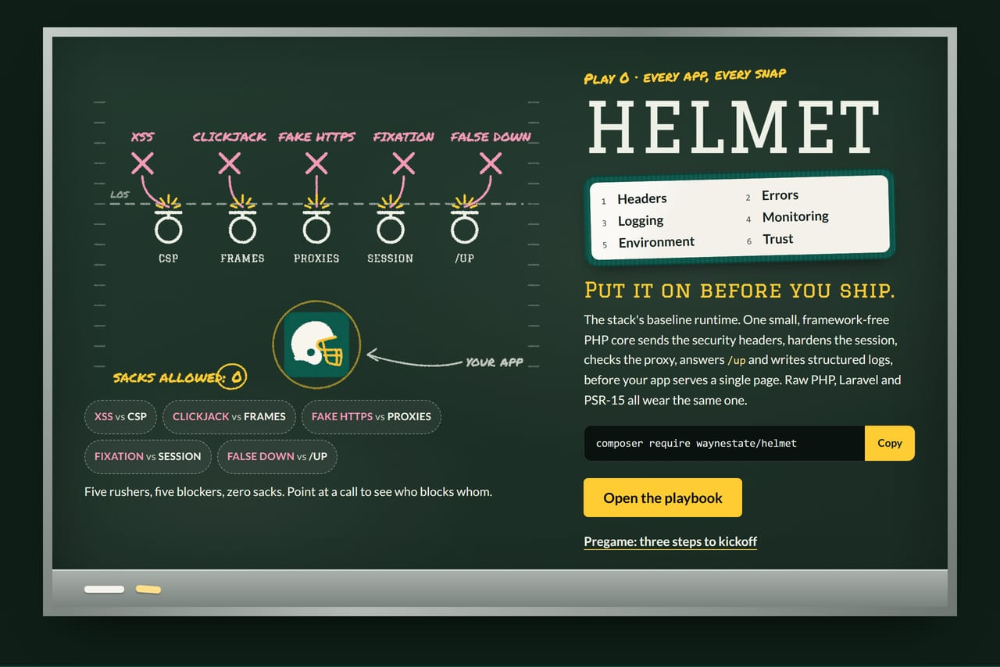
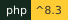
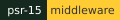
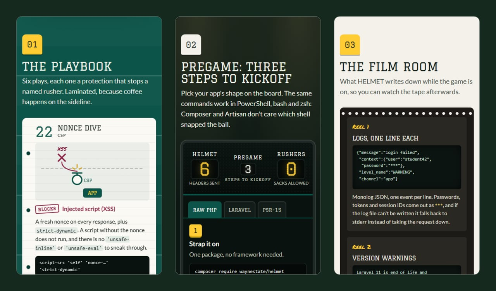
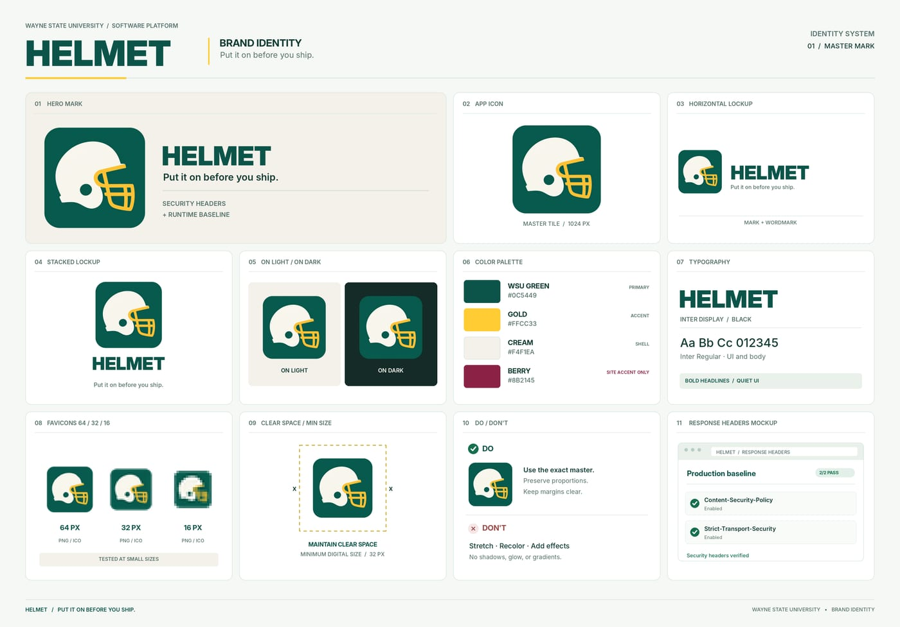

<div align="center">
  <a href="site/index.html"></a>
</div>

# HELMET


<sub>GIF via [Tenor](https://tenor.com/view/helmet-band-wilmas-rainbow-helmet-band-music-gif-25658120)</sub>

<p>
  
  
  
  <a href="https://github.com/waynestate/helmet/actions/workflows/ci.yml"></a>
</p>

**Put it on before you ship.** Security headers, a hardened session and an honest proxy check, snapped on before
the first page is served.

Checks: `composer ci` (the same command runs on GitLab and GitHub).
Two mirrors, one command: the only thing in this repo that plays both sides is the CI.
Front page: [`site/index.html`](site/index.html), the playbook, as static files ([`site/README.md`](site/README.md)).
On Citadel it is served by the raw-PHP deploy layer in [`deploy/`](deploy/): a Squire kit whose front controller serves `site/` behind HELMET's security headers. For local development, keep serving `site/` directly.

HELMET is the Wayne State app stack's baseline runtime. One small
framework-free PHP core, `Waynestate\Helmet`, does the five things every app on
Citadel needs before it serves a single page: it sends the security headers,
hardens the session, decides whether the request really arrived over HTTPS,
answers the load balancer's `/up` ping, and writes structured logs.

This repository is published from Wayne State University's internal
GitLab and mirrored here. Changes land there first; Wayne State
developers open issues and merge requests on the internal project.

It is the floor, not the ceiling. An app on raw PHP calls `helmet_boot()` once
at the top of its front controller and is done. An app on Laravel or a PSR-15
stack mounts the same core as middleware and gets the identical headers. The
rules live in one place, and every consumer path agrees.

## Install

```
composer require waynestate/helmet
```

<details>
<summary><b>Walk the sideline</b>: the front page's playbook, pregame and film room</summary>
<br>
<div align="center"></div>
</details>

## Platform presets

A preset names a platform's trusted-proxy list, so an app does not hard-code
an address that belongs to the platform, not the app. The presets live in
`Waynestate\Helmet\Platform\Presets`:

| Preset | Trusted proxies |
| --- | --- |
| `citadel` | the Docker bridge gateway to the HA-Proxy front (see "Running off Citadel") |
| `docker` | none: a plain Docker network with no front proxy |

Raw PHP passes the preset name:

```php
$helmet = helmet_boot([
    'preset' => 'citadel',
]);
```

Laravel reads it from `HELMET_PRESET` (see the environment table below;
Playbook supplies it when the environment has none); an explicit
`HELMET_PROXIES` always wins over the preset.

Off the WSU platform, skip the preset and pass your own list of the addresses
your front proxy connects from:

```php
$helmet = helmet_boot([
    'trusted_proxies' => ['203.0.113.10'],
]);
```

An unknown preset name throws at boot, so a typo fails loudly instead of
silently trusting nothing.

## WSU values (Playbook)

The Laravel config reads `HELMET_PRESET` from the environment first and from
the private `waynestate/playbook` package (Playbook) second, when the
environment has no value. The raw PHP path takes the preset as an option to
`helmet_boot()` and reads no environment at all.

| Setting | What it is |
| --- | --- |
| `HELMET_PRESET` | A platform preset name (`citadel` or `docker`) that supplies the trusted proxies. |

Get Playbook with your own GitLab token, three ways.

Composer: add the repository to your app's `composer.json`, put the token in
`auth.json` (Composer's credential store, never in the repo), then require
the package:

```json
{
    "repositories": [
        {
            "type": "vcs",
            "url": "https://git.wayne.edu/enterprise-apps/playbook.git"
        }
    ]
}
```

```
composer require waynestate/playbook
```

Or fetch the values file directly.

curl (Linux, macOS):

```
curl --fail -H "PRIVATE-TOKEN: $GITLAB_TOKEN" "https://git.wayne.edu/api/v4/projects/enterprise-apps%2Fplaybook/repository/files/playbook.env/raw?ref=main" -o .env.playbook
```

PowerShell (Windows):

```
Invoke-WebRequest -Headers @{ 'PRIVATE-TOKEN' = $env:GITLAB_TOKEN } -Uri "https://git.wayne.edu/api/v4/projects/enterprise-apps%2Fplaybook/repository/files/playbook.env/raw?ref=main" -OutFile .env.playbook
```

Clone:

```
git clone https://git.wayne.edu/enterprise-apps/playbook.git
```

A fetched `.env.playbook` is plain `KEY=value` lines: copy the ones you need
into your app's `.env` (or your Citadel environment).

The token is your own: `read_api` for curl, `read_repository` for clone and
Composer.

Playbook is private on git.wayne.edu. If you get a 404, ask the Enterprise
Applications team for read access.

## Running off Citadel

HELMET ships one package for every platform, so running off Citadel means
changing configuration, not code. The only platform fact it needs is the
address of whatever stands in front of the app container:

| Platform | What sits in front | `HELMET_PROXIES` | Where logs go |
| --- | --- | --- | --- |
| Citadel | HA-Proxy | use the `citadel` preset (`172.18.0.1`) | `/var/log/app/helmet.log`, the preset's file path |
| OpenShift | the OpenShift router | the router's pod network CIDR, from your cluster admin | `php://stderr` |
| Coolify | Traefik or Caddy | the Docker network of the proxy | `php://stderr` |
| Raw Docker behind a compose proxy | your proxy service | the compose network's subnet | `php://stderr` |

An explicit `HELMET_PROXIES` overrides the preset on every platform. With
neither a preset nor a list, no address is trusted, so forwarded headers
such as `X-Forwarded-Proto` are ignored and the request is read as it arrived. Off Citadel, log to `php://stderr` and
let the container runtime collect the lines.

The helmet comes off the platform, not the app.

## Usage

### Raw PHP

At the top of the front controller, before anything is echoed:

```php
use function Waynestate\Helmet\helmet_boot;

$helmet = helmet_boot([
    // The platform preset that supplies the trusted proxies. An explicit
    // 'trusted_proxies' list wins over the preset.
    'preset' => 'citadel',

    // Optional. A Monolog JSON logger, one line per record. "stream" may be a
    // stream or a file path. Off Citadel, lead with php://stderr; the
    // Citadel preset's value is /var/log/app/helmet.log. Every record carries
    // a request ID in extra.request_id, generated by HELMET; an inbound
    // header is never trusted for it. Set "request_id" to reuse an ID you
    // already have (8 to 64 letters, digits, dots, underscores or dashes).
    'log' => [
        'channel' => 'app',
        'stream'  => 'php://stderr',
        'level'   => 'info',
        // 'request_id' => 'req-20261029-abcd',
    ],
]);

// $helmet['nonce'] is the per-request CSP nonce. Put it in your <script> tags.
// $helmet['logger'] is a Psr\Log\LoggerInterface, or null when no log is set.
// $helmet['request_id'] is the ID stamped on this process's log records.
```

Each record is one JSON line:

```json
{"message":"login","context":{"user":"alice"},"level":200,"level_name":"INFO","channel":"app","datetime":"2026-10-29T12:00:00.000000+00:00","extra":{"request_id":"9f2c1ab04d5e6f70"}}
```

Use a platform preset (for example `citadel`, which trusts the Docker bridge
gateway), or list only the address the front proxy connects from, never a
whole private range. A broad range such as `10.0.0.0/8` also trusts other
containers on the same network, and any of them could then set
`X-Forwarded-Proto`.

`helmet_boot()` sends the headers, strips `X-Powered-By`, and answers `/up`
with `200 ok` before your code runs. It returns the nonce, the logger and
the request ID so the rest of the app can use them.

#### Health check without a front controller

A raw PHP app with no front controller (or an Apache setup with no rewrite)
never reaches `helmet_boot()` for `/up`. Ship a two-line `public/up.php`
that calls HELMET directly:

```php
<?php // public/up.php
use function Waynestate\Helmet\helmet_up;

require __DIR__ . '/../vendor/autoload.php';
helmet_up();
```

Squire's raw template ships this file. The probe only checks that the ball
is in the air; it does not grade the play.

### PSR-15 middleware

The same core, mounted in a middleware pipeline:

```php
use Nyholm\Psr7\Factory\Psr17Factory;
use Waynestate\Helmet\Csrf\RequestForgeryGuard;
use Waynestate\Helmet\Headers\SecurityHeadersMiddleware;
use Waynestate\Helmet\Health\HealthCheck;
use Waynestate\Helmet\Platform\Presets;
use Waynestate\Helmet\Proxy\TrustedProxies;

$factory = new Psr17Factory();
$proxies = new TrustedProxies(Presets::proxies('citadel'));

$middleware = [
    new HealthCheck($factory, $factory, '/up'),
    new RequestForgeryGuard($proxies, $factory, $factory, except: ['/api/webhooks/*']),
    new SecurityHeadersMiddleware($proxies),
];
```

`SecurityHeadersMiddleware` sets the request attribute `helmet.csp_nonce` so a
downstream handler can read the same nonce the CSP header carries.

`RequestForgeryGuard` is opt-in: mounting it turns the check on for that
pipeline. Its options are described in
[The request-forgery guard](#the-request-forgery-guard).

The headers are sent even when the inner handler throws. By default the
middleware rethrows, so the framework's error handler still runs and produces
the error page; pass `rethrow: false` (and a PSR-17 `ResponseFactory`) to make
the middleware itself return a `500` carrying the same headers. The raw PHP
path needs no such flag: `helmet_boot()` sends the headers before your code
runs, so they are already on the wire by the time an exception can happen.

### Laravel

The Laravel adapter is a service provider, two always-on middlewares, an
optional request-forgery guard, and a config file.
It only wires and configures. Every rule (what the headers say, how a nonce is
made, how a CSP is merged, and how a request-forgery check is applied) lives in
the core, so Laravel and raw PHP cannot drift apart. The suite runs against
Laravel 13 with Orchestra Testbench.

#### Install the adapter

Strap It On:

```
composer require waynestate/helmet
```

Package discovery registers `Waynestate\Helmet\Laravel\HelmetServiceProvider`,
so there is nothing to add to `bootstrap/providers.php`. The provider merges
the `helmet` config and joins the HTTP kernel's middleware:

- `SecurityHeaders` sends the headers in [The headers](#the-headers) and strips
  `X-Powered-By`. By default it is global, so 404s and JSON routes carry them
  too.
- `InjectRibbon` adds the environment ribbon (below). It always stays in the
  `web` group, because it edits HTML.
- `RequestForgeryGuard` is opt-in. When `helmet.csrf.enabled` is true, it joins
  the `web` group after `InjectRibbon` and applies the check in
  [The request-forgery guard](#the-request-forgery-guard).

They are added through the HTTP kernel, so they survive another package adding
to the same group. Set `HELMET_SCOPE=web` to keep `SecurityHeaders` in the
`web` group only; then routes outside `web` and unmatched 404s do not carry
its headers.

#### Publish the config

```
php artisan vendor:publish --tag=helmet-config
```

This copies `config/helmet.php` into your app. Do it: it is the best place to
change the CSP, because the policy is a PHP array there, not JSON squeezed into
`.env`. The config file is also the one place HELMET reads the environment
(`env()`, plus `HELMET_PRESET` through `Setting`, which also checks Playbook),
so `php artisan config:cache` keeps working.

#### Trust the proxy

HELMET decides on its own whether a request was really HTTPS, from
`HELMET_PROXIES`. Laravel has a separate trusted-proxy setting that drives
`url()`, secure cookies and `$request->isSecure()`. The provider follows the
same list: when the app has not set `trustedproxy.proxies` itself, it copies
`helmet.proxies` over, so `HELMET_PROXIES` drives both. An app that sets
`trustedproxy.proxies` keeps its own value, and an explicit
`trustProxies(at: ...)` call in `bootstrap/app.php` still wins, because
Laravel applies it before the config fallback.

The provider also narrows which forwarded headers Laravel believes from those
proxies: `X-Forwarded-For` and `X-Forwarded-Proto`, and nothing else.
Laravel's own default also trusts `X-Forwarded-Host`, `X-Forwarded-Prefix`
and `X-Forwarded-Port`, and a client can pre-seed any of them on a platform
whose proxy does not overwrite them, which poisons `url()`, redirects and
password-reset links. Port is out for the same reason: Citadel's HA-Proxy
never sends it at all, so a client-sent value would pass through untouched
and change the port Laravel reports and the URLs it generates. If your app
needs one of them, choose the set yourself with
`trustProxies(at: ..., headers: ...)` in `bootstrap/app.php` (or
`TrustProxies::withHeaders()`); HELMET then leaves your choice alone.

Citadel's HA-Proxy *appends* `X-Forwarded-Proto` instead of replacing it, so
a client can arrive with two values, `https, http`. Symfony reads the first
value of such a list (the client's), while HELMET reads the last (the one
the closest proxy appended). To keep Laravel in agreement, the provider
prepends a small middleware to the global chain that rewrites the header to
its last value when the request comes from a trusted proxy. A single value
is left alone, and requests from untrusted peers are ignored as before.

As in the raw PHP section, use a preset or list only the address your front
proxy connects from, never a whole private range.

The `/up` health route is Laravel's own: keep `health: '/up'` in
`withRouting()`. The adapter registers no route.

#### Environment variables

| Variable | Config key | Default | What it does |
| --- | --- | --- | --- |
| `HELMET_SCOPE` | `helmet.scope` | `global` | `global` puts `SecurityHeaders` in the kernel's global middleware; `web` keeps it in the `web` group only. `InjectRibbon` always stays in `web`. |
| `HELMET_PRESET` | `helmet.preset` | none | A platform preset name (`citadel` or `docker`) that supplies the trusted proxies. Read from the environment, else from Playbook (see [WSU values (Playbook)](#wsu-values-playbook)). `HELMET_PROXIES` wins when both are set. An unknown name throws, even when `HELMET_PROXIES` is set. |
| `HELMET_PROXIES` | `helmet.proxies` | none | Comma-separated IPs or CIDR ranges allowed to set `X-Forwarded-Proto`. Wins over `HELMET_PRESET`. Also copied to `trustedproxy.proxies` when the app has not set it. Empty trusts nothing. |
| `HELMET_CSP` | `helmet.csp` | the core default policy | A JSON policy array, merged over the default (see below). Empty or invalid JSON keeps the default. |
| `HELMET_HSTS_MAX_AGE` | `helmet.hsts` | `31536000` | The HSTS `max-age` in seconds, sent on HTTPS only. It must not be negative. |
| `HELMET_HSTS_INCLUDE_SUBDOMAINS` | `helmet.hsts_include_subdomains` | `true` | Set `false` to omit the HSTS `includeSubDomains` directive. |
| `HELMET_HSTS_PRELOAD` | `helmet.hsts_preload` | `false` | Set `true` to append the `preload` directive to HSTS. Requires `max-age` of at least one year and `includeSubDomains`. Preload is hard to undo: once a browser has preloaded the domain it refuses plain-HTTP connections until the entry is removed. |
| `HELMET_CSP_TRUSTED_TYPES_ENABLED` | `helmet.csp_trusted_types.enabled` | `false` | Set `true` to append Trusted Types directives to the report-only CSP header. |
| `HELMET_CSP_TRUSTED_TYPES_POLICIES` | `helmet.csp_trusted_types.policies` | `["default"]` | Comma-separated Trusted Types policy names. |
| `HELMET_NO_STORE_ENABLED` | `helmet.no_store.enabled` | `false` | Set `true` to send `Cache-Control: no-store` on matching responses. |
| `HELMET_NO_STORE_PATHS` | `helmet.no_store.paths` | none | Comma-separated path prefixes that carry no-store. Empty means every response. |
| `HELMET_RIBBON` | `helmet.ribbon` | `true` | Set `false` to switch the ribbon off everywhere. |
| `HELMET_POLICY_PATH` | `helmet.policy_path` | none | Path to a CREED `policy.json`. When set, the ribbon shows a version warning for the running PHP (and, in Laravel, the framework) version. A missing or invalid file shows no warning and never breaks the page. |
| `HELMET_DEV_ORIGIN` | `helmet.dev_origin` | none | The Vite dev server origin, used in `local` only when the dev server is running. Must be `http` or `https` on `localhost`, `127.0.0.1` or `[::1]`. Overrides the hot file. |
| `HELMET_CSP_REPORT_URI` | `helmet.csp_report_uri` | none | The URL browsers POST CSP violation reports to. Adds `report-uri` and `report-to` to the policy and a `Reporting-Endpoints` header. Must be `https`. |
| `HELMET_CSP_REPORT_ONLY` | `helmet.csp_report_only` | `false` | Set `true` to send the policy as `Content-Security-Policy-Report-Only` (observe violations without blocking them). |
| `HELMET_CSRF_ENABLED` | `helmet.csrf.enabled` | `false` | Set `true` to turn on the request-forgery guard for state-changing requests. |
| `HELMET_CSRF_ALLOW_SAME_SITE` | `helmet.csrf.allow_same_site` | `false` | Set `true` to let `Sec-Fetch-Site: same-site` pass. Off by default because sibling subdomains are still same-site. |
| `HELMET_CSRF_TRUSTED_ORIGINS` | `helmet.csrf.trusted_origins` | none | Comma-separated origins allowed to make state-changing requests when the `Origin` fallback is used. |
| `HELMET_CSRF_EXCEPT` | `helmet.csrf.except` | none | Comma-separated path patterns that skip the guard: an exact path, a prefix ending in `*`, or `*` for every path. |

#### Customizing the CSP in Laravel

`helmet.csp` takes the same shape as the raw PHP `csp` option and follows the
same rule: it is merged over the default, per directive. A directive you set
replaces the default's, a directive you leave out keeps it, and `null` removes
one. Open the published `config/helmet.php` and replace the
`$csp = SecurityHeaders::defaultCspPolicy();` line:

```php
$csp = [
    'img-src' => ["'self'", 'data:', 'https://images.example.edu'],
    'form-action' => null,
];
```

If you would rather use the environment, `HELMET_CSP` takes the same array as
JSON. In a `.env` file it needs double quotes and escaped inner quotes, which
is the reason to publish the config instead:

```
HELMET_CSP="{\"img-src\":[\"'self'\",\"data:\"],\"form-action\":null}"
```

Invalid JSON is ignored and the default policy stays, so a typo in the
environment cannot loosen the CSP.

One gotcha when overriding: the policy adds the per-request nonce to
`style-src` and `style-src-elem`. A browser ignores `'unsafe-inline'` once a
nonce is present, so setting `style-src` to `["'unsafe-inline'"]` does not
restore inline styles; it removes them.

#### The nonce in Blade

The middleware puts the per-request nonce on the request as the attribute
`helmet.csp_nonce`, the same name the PSR-15 middleware uses. It also hands
the nonce to Laravel's Vite helper, so `@vite` needs nothing: the `script` and
`style` tags it print already carry the nonce the CSP header sends.

For an inline script, print the nonce from the Vite helper:

```blade
<script nonce="{{ Vite::cspNonce() }}">
    // allowed by the nonce, and free to load more scripts (strict-dynamic)
</script>
```

In a controller it is `$request->attributes->get('helmet.csp_nonce')`. A new
nonce is made for every request. Repetition is a fine Helmet song and a
terrible nonce.

#### Vite and Inertia

The middleware hands the per-request nonce to Laravel's Vite helper and
injects a `csp-nonce` meta tag into `<head>`. `@vite` needs nothing. The meta
tag lets Vite's dev runtime nonce the CSS and preload tags it adds after page
load.

A few rules keep the CSP honest:

- **Nonce every inline script.** The CSP has no `'unsafe-inline'` for
  scripts. Every `<script>` without a `src` needs
  `nonce="{{ Vite::cspNonce() }}"`.
- **No `'unsafe-eval'`.** The CSP never allows it. If your bundle needs
  `eval`, fix the bundle.
- **No scripts in Inertia's `<Head>`.** Inertia's `<Head>` renders into the
  document head after the page loads. A `<script>` there would not carry the
  nonce, and the browser would block it. Put scripts in your layout, where
  `@vite` and the nonce reach them.
- **No second nonce-producing package.** If another package calls
  `Vite::useCspNonce()` after HELMET, the `@vite` tags carry a different nonce
  than the CSP header, and the browser blocks the scripts. The middleware logs
  a warning when it detects this.
- **No shared caching of nonced HTML.** The nonce changes every request. A
  cached page would carry a stale nonce, and the browser would block its
  scripts. Do not cache HTML at a layer that shares it across requests.
- **Do not replace `style-src` with `'unsafe-inline'`.** The policy adds the
  per-request nonce to `style-src` and `style-src-elem`, and a browser
  ignores `'unsafe-inline'` once a nonce is present. An override that relies
  on it loses every inline style silently. Keep the nonce, move the styles
  into files, or give the inline styles a nonce.

In raw PHP, print the meta tag in `<head>` with the nonce `helmet_boot()`
returned:

```php
echo helmet_csp_nonce_meta($helmet['nonce']);
```

The Vite dev server is allowed in the `local` environment only, and only when
it is running (a hot file exists). The origin comes from `HELMET_DEV_ORIGIN`
when set, otherwise from the hot file. It must be `http` or `https` on
`localhost`, `127.0.0.1` or `[::1]`, with an optional port. An invalid origin
is ignored and a warning is logged. In every other environment the dev server
origin is never added.

#### The ribbon

In `local`, `development`, `dev`, `testing`, `test` and `staging`, `InjectRibbon`
adds `<div class="helmet-ribbon" data-environment="staging">staging</div>`
right after the opening `<body>` tag of an HTML response, so nobody mistakes a
test site for the real one. It never appears in `production`, on JSON or other
non-HTML responses, or on HTML with no `<body>`. The package ships no
stylesheet; style `.helmet-ribbon` in your own CSS. Even with
`HELMET_RIBBON=true`, production never gets it, so there is no Aftertaste.

**Version warnings.** Point `HELMET_POLICY_PATH` at a CREED `policy.json` and
the ribbon gains a warning line for each component version that is in its
security-only phase or end of life. The raw PHP path checks the running PHP
version; the Laravel adapter also checks the framework's major version. With
no policy path there is no warning and no file read, and a missing, unreadable
or invalid file shows no warning and never breaks the page. Style
`.helmet-ribbon-warning` in your own CSS.

#### Raw PHP and Laravel agree

Both paths call `SecurityHeaders::build()`, so for the same request and
settings they send the same headers. A test pins that down: it compares what
the Laravel middleware sends, name and value, with `build()`. The settings map
like this:

| Setting | Raw PHP (`helmet_boot()`) | Laravel |
| --- | --- | --- |
| Trusted proxies | `trusted_proxies` | `HELMET_PROXIES` / `helmet.proxies` |
| CSP overrides | `csp` | `HELMET_CSP` / `helmet.csp`, same merge, `null` removes |
| HSTS max-age | `hsts_max_age` | `HELMET_HSTS_MAX_AGE` / `helmet.hsts` |
| HSTS subdomains | `hsts_include_subdomains` | `HELMET_HSTS_INCLUDE_SUBDOMAINS` / `helmet.hsts_include_subdomains`, default `true` |
| HSTS preload | `hsts_preload` | `HELMET_HSTS_PRELOAD` / `helmet.hsts_preload`, default `false` |
| Trusted Types | `csp_trusted_types` | `HELMET_CSP_TRUSTED_TYPES_*` / `helmet.csp_trusted_types.*`, default off |
| no-store | `no_store` | `HELMET_NO_STORE_*` / `helmet.no_store.*`, default off |
| CSP report URI | `csp_report_uri` | `HELMET_CSP_REPORT_URI` / `helmet.csp_report_uri` |
| CSP report-only | `csp_report_only` | `HELMET_CSP_REPORT_ONLY` / `helmet.csp_report_only`, default `false` |
| COOP | `coop` | `HELMET_COOP` / `helmet.coop`, default `same-origin`, `null` sends no header |
| CORP | `corp` | `HELMET_CORP` / `helmet.corp`, default `null` (no header) |
| Permissions-Policy | `permissions_policy` | `HELMET_PERMISSIONS_POLICY` / `helmet.permissions_policy`, default deny list, `[]` sends no header |
| Nonce | `$helmet['nonce']` | `request()->attributes->get('helmet.csp_nonce')` |
| Health check | `health_path`, answered by `helmet_boot()` | Laravel's `health: '/up'` |
| Request-forgery guard | `csrf` option to `helmet_boot()` | `helmet.csrf.*` / `HELMET_CSRF_*`; the middleware is registered only when enabled |
| Session hardening, JSON logs | applied by `helmet_boot()` | not applied by the adapter; Laravel's session and logging config apply |

For session hardening in Laravel, use the framework's own session config: set `secure`, `http_only`, and `same_site` in `config/session.php` rather than expecting the adapter to apply raw-PHP `SessionHardening`. For structured logs, use Laravel's log channels, for example the `stderr` channel, rather than expecting the adapter to configure a raw-PHP logger.

## The headers

<div align="center">
  
  <br>
  <sub>The play is read from <code>src/Headers/SecurityHeaders.php</code>: seven routes, one per default header,
  drawn in the order HELMET sets them. Cross-Origin-Resource-Policy waits on the bench until you opt in. With
  reduced motion on, you get the finished play.</sub>
</div>

Every response gets the same set, built by one shared function:

| Header | Value |
| --- | --- |
| `Content-Security-Policy` | the WayneUI default policy, plus a per-request nonce and `strict-dynamic` |
| `X-Content-Type-Options` | `nosniff` |
| `X-Frame-Options` | `SAMEORIGIN` |
| `Referrer-Policy` | `strict-origin-when-cross-origin` |
| `Permissions-Policy` | `camera=(), geolocation=(), microphone=(), payment=(), usb=()` by default, configurable |
| `Cross-Origin-Opener-Policy` | `same-origin` by default, configurable, `null` sends no header |
| `Cross-Origin-Resource-Policy` | not sent by default, opt-in |
| `Strict-Transport-Security` | `max-age=31536000; includeSubDomains` by default, HTTPS only, configurable |

The default CSP is the union of the WayneUI recipes, with `frame-ancestors
'self'`, `base-uri 'self'`, `object-src 'none'` and `form-action 'self'` added
so an app can never be framed by a stranger, have its base tag hijacked, load
plugins, or post its forms to an attacker. `script-src` carries a per-request
nonce plus `strict-dynamic`, so a script loaded with the nonce can load other
scripts without opening the door to `'unsafe-inline'`.

Milquetoast is a Helmet song. It is not a Content-Security-Policy.

### Customizing the CSP

Pass a `csp` policy (raw PHP) or a second constructor argument (middleware).
It is merged over the default, per directive: a directive you set replaces the
default's value for that directive, and a directive you leave out keeps the
default. To remove a directive the default sets, set it to `null`:

```php
$helmet = helmet_boot([
    'preset' => 'citadel',
    'csp' => [
        // Replace the default img-src.
        'img-src' => ["'self'", 'data:'],
        // Remove form-action entirely.
        'form-action' => null,
    ],
]);
```

### Configuring HSTS

The default is `max-age=31536000; includeSubDomains` (one year, all
subdomains), sent on HTTPS responses only. Roll it out in stages: start with a
short `max-age`, raise it once nothing breaks, and keep `includeSubDomains`
only when every subdomain serves HTTPS. `preload` is a decision for the domain
owner, not for one app, so HELMET never adds it.

Set `hsts_max_age` (seconds) and `hsts_include_subdomains` (raw PHP), or pass
the last two constructor arguments (middleware):

```php
$helmet = helmet_boot([
    'preset' => 'citadel',
    'hsts_max_age' => 600,
    'hsts_include_subdomains' => false,
]);
```

### CSP reports

By default the policy is enforced: a violation is blocked. To see what would
be blocked before you enforce it, or to keep collecting reports after you do,
point the policy at a report endpoint.

Set `csp_report_uri` (raw PHP) or `HELMET_CSP_REPORT_URI` (Laravel) to the URL
browsers POST reports to. It must be `https`. HELMET then adds `report-uri` and
`report-to` to the policy and sends a `Reporting-Endpoints` header naming the
endpoint. Set `csp_report_only` (or `HELMET_CSP_REPORT_ONLY`) to `true` to send
the policy as `Content-Security-Policy-Report-Only`, which observes violations
without blocking them.

```php
$helmet = helmet_boot([
    'preset' => 'citadel',
    'csp_report_uri' => 'https://app.example.edu/csp-report',
    'csp_report_only' => true,
]);
```

An invalid URI (not `https`, no host, or a value carrying whitespace or a
quote) throws at boot, so a typo fails loudly instead of pointing the browser
at a destination it cannot reach.

Laravel ships an opt-in endpoint that receives the reports and logs one line
per violation (the violated directive, the blocked URI's host, and the
document path) and nothing else. It accepts both report formats: the legacy
`application/csp-report` object, and the Reporting API's
`application/reports+json` array, from which it logs the `csp-violation`
entries (at most 20 per POST; browsers batch other report types into the
same request, and those are ignored). The route is off until you register it:

```php
// routes/web.php
Route::cspReport();                 // POST /csp-report
Route::cspReport('/reports/csp');   // or your own path
```

The endpoint caps the body at 16 KiB, returns `204`, and carries no
authentication of its own; wrap it in your own middleware if you want to keep
it private. Browsers POST reports without a CSRF token, so the route excludes
the `web` group's CSRF middleware. Because the endpoint is public and its
input is attacker-influenced, it is throttled by default to 60 reports a
minute per IP (`throttle:60,1`); pass a second argument to use a different
throttle, or `null` to disable it:

```php
Route::cspReport('/reports/csp', 'throttle:120,1'); // your own limit
Route::cspReport('/reports/csp', null);             // no throttle
```

### Cross-origin isolation and feature policy

Three more headers round out the baseline: two are on by default, one is
opt-in.

`Cross-Origin-Opener-Policy` defaults to `same-origin`, which puts the page in
its own browsing-context group so an opener or parent page cannot read it. Set
`coop` (raw PHP) or `HELMET_COOP` (Laravel) to `same-origin-allow-popups` or
`noopener-allow-popups` to keep the isolation but let a popup window (such as
an OAuth login popup to the IdP) stay cross-origin, or to `unsafe-none` to
turn the header off. Set it to `null` to send no COOP header at all.

`Cross-Origin-Resource-Policy` is opt-in: HELMET sends no CORP header by
default, because a blanket `same-site` can break an app whose assets are read
cross-origin. Set `corp` (raw PHP) or `HELMET_CORP` (Laravel) to `same-site`,
`same-origin` or `cross-origin` to send it.

`Permissions-Policy` defaults to a deny list: `camera`, `geolocation`,
`microphone`, `payment` and `usb` are all denied, so an injected script cannot
use a feature the page has switched off. Set `permissions_policy` (raw PHP) or
`HELMET_PERMISSIONS_POLICY` (Laravel) to a feature map to change it: each
feature maps to an allowlist of `self` and https origins, and an empty
allowlist denies the feature. An empty map sends no Permissions-Policy header.

```php
$helmet = helmet_boot([
    'preset' => 'citadel',
    'coop' => 'same-origin-allow-popups',
    'corp' => 'same-site',
    'permissions_policy' => [
        'camera' => ['self'],
        'geolocation' => [],
    ],
]);
```

An invalid COOP or CORP value, or a Permissions-Policy feature name or
allowlist entry that is not `self` or an https origin, throws, so a typo fails
loudly instead of sending a header the browser will ignore.

## HTTPS, and why the proxy list matters

Citadel sits behind HA-Proxy, so the PHP process sees the proxy's address, not
the client's, and the real scheme arrives in `X-Forwarded-Proto`. HELMET only
honors that header when the connection came from a trusted proxy. A spoofed
`X-Forwarded-Proto: https` from the public internet is ignored, and no HSTS
header is sent for a request that was not really secure.

The proxy check is the Unsung hero of the headers. Nobody notices it until a
forged `X-Forwarded-Proto` walks in and gets nowhere.

## The session

`SessionHardening::apply()` sets these `ini` values before the session
starts. It refuses to run once a session is active, because changing them
mid-session does nothing.

| Setting | Value | Why |
| --- | --- | --- |
| `session.use_strict_mode` | `1` | Rejects session IDs the server did not issue, which blocks fixation. |
| `session.use_only_cookies` | `1` | The session ID travels only in the cookie, never in a URL. |
| `session.cookie_httponly` | `1` | JavaScript cannot read the session cookie. |
| `session.cookie_samesite` | `Lax` | Cuts cross-site session reuse. |
| `session.cookie_secure` | `1` on HTTPS, unset otherwise | The cookie is sent only over TLS, and plain-HTTP setups keep working. |
| `session.cookie_lifetime` | `0` | A browser-session cookie: it ends when the browser closes. |
| `session.cache_limiter` | `nocache` | Pages cannot be cached and replayed with the session attached. |
| `session.cookie_path` | `/` | The usual scope, and required by the `__Host-` prefix. |
| `session.cookie_domain` | empty | Host-only: the cookie is not sent to sibling subdomains. |
| `session.name` | `__Host-WSUSESSID` on HTTPS, `WSUSESSID` on HTTP | A generic name reveals less, and the `__Host-` prefix makes the browser reject the cookie unless it is `Secure`, `Path=/` and has no `Domain`. |

The name rule applies only while the name is still PHP's default
`PHPSESSID`. An app that chose its own name keeps it, and SESAME reads
whatever `session_name()` returns, so a changed name is safe for it. When an
app first runs this version, existing sessions under the old name end: the
next request still carries the old cookie, the app finds no session under
the new name and starts a fresh one.

## The request-forgery guard

`SameSite=Lax` is a layer, not a wall. HELMET can also check state-changing
requests before they reach the app. The guard is off by default; when it is on,
it is the same rule on every consumer path.

For `GET`, `HEAD` and `OPTIONS` the request passes. For anything else:

1. `Sec-Fetch-Site` is the primary signal when the browser sends it.
   `same-origin` and `none` pass, `same-site` passes only when
   `allow_same_site` is true, and `cross-site` or an unknown value is
   rejected.
2. When `Sec-Fetch-Site` is absent, the `Origin` header is checked against the
   request's own origin and `trusted_origins`. `Origin: null` is rejected, an
   unparseable origin is rejected, and an absent origin passes, because a
   non-browser client authenticates some other way.
3. A path in `except` skips the guard. A pattern is an exact path, a prefix
   ending in `*`, or `*` for every path.

A rejected request receives `403`, `Content-Type: text/plain; charset=utf-8`,
`Cache-Control: no-store` and the body `Forbidden`. The answer never echoes
request headers.

### Raw PHP

```php
$helmet = helmet_boot([
    'preset' => 'citadel',
    'csrf' => [
        'enabled' => true,
        'allow_same_site' => false,
        'trusted_origins' => ['https://forms.example.edu'],
        'except' => ['/api/webhooks/*'],
    ],
]);
```

`helmet_boot()` runs the check after the health path and before the security
headers. A rejected request stops there.

### PSR-15

```php
use Waynestate\Helmet\Csrf\RequestForgeryGuard;

$guard = new RequestForgeryGuard(
    $proxies,
    $factory,
    $factory,
    false,
    ['https://forms.example.edu'],
    ['/api/webhooks/*'],
);
```

The guard needs the PSR-17 response and stream factories only when it rejects
a request.

### Laravel

Set the config or the environment:

```
HELMET_CSRF_ENABLED=true
HELMET_CSRF_TRUSTED_ORIGINS=https://forms.example.edu
HELMET_CSRF_EXCEPT=/api/webhooks/*
```

The provider registers the `RequestForgeryGuard` middleware in the `web` group
only when `helmet.csrf.enabled` is true. It calls the same core rule, so a
Laravel app and a raw PHP app with the same settings make the same decision.

## Metrics

HELMET can expose a Prometheus metrics endpoint. It is off by default and
stays off until you turn it on. No Prometheus scraper is wired yet; the
endpoint is there for when one is.

### Enable it

Set `HELMET_METRICS_ENABLED=true` and choose at least one way to prove who is
asking:

| Variable | What it does |
| --- | --- |
| `HELMET_METRICS_TOKEN` | A bearer token. The scraper sends `Authorization: Bearer <token>`. Compared with `hash_equals`. |
| `HELMET_METRICS_ALLOW` | Comma-separated IPs or CIDR ranges allowed to scrape without a token. |

With neither set the endpoint returns `404` and logs a warning, so a
misconfigured app does not hand its metrics to the whole network.

### Laravel

The provider registers a `Route::helmetMetrics()` macro. The route is not
created until you call it:

```php
// routes/web.php
Route::helmetMetrics();                          // GET /metrics, throttle:60,1
Route::helmetMetrics('/metrics', 'throttle:120,1'); // your own throttle
Route::helmetMetrics('/metrics', null);           // no throttle
```

The controller reads `helmet.metrics` from the published config, resolves the
client IP through the same trusted-proxy list the headers use, and renders
`text/plain; version=0.0.4`.

### Raw PHP

```php
use function Waynestate\Helmet\helmet_metrics;

$result = helmet_metrics([
    'enabled' => true,
    'token'   => 's3cret',
    'allow'   => ['10.0.0.0/8'],
    'preset'  => 'citadel',
]);

http_response_code($result['status']);
header('Content-Type: ' . $result['content_type']);
echo $result['body'];
```

The response carries a `helmet_info` gauge with the PHP and HELMET versions,
and a `helmet_php_version_status` gauge when a `PolicySource` is available.
No personal data in labels; labels stay low-cardinality.

The endpoint is the only place in HELMET that says "I am still here" without
saying "here is your page". A lullaby, in a way.

## Proof

Proof runs against real Wayne State applications are on a private site, [proof.apps.wayne.edu/helmet](https://proof.apps.wayne.edu/helmet/), behind a Wayne State employee sign-in.

## Tests

Maintainers: how to build, test and release this project, and where its data comes from, is in [MAINTAINING.md](MAINTAINING.md).

No PHP on the machine? Fine. Docker runs the suite:

```
docker run --rm -v "${PWD}:/app" -w /app composer:2 composer install --no-interaction
docker run --rm -v "${PWD}:/app" -w /app php:8.5-cli vendor/bin/phpunit
docker run --rm -v "${PWD}:/app" -w /app php:8.4-cli vendor/bin/phpunit
docker run --rm -v "${PWD}:/app" -w /app php:8.3-cli vendor/bin/phpunit
```

Style and static analysis come from [Pinstripe](https://github.com/waynestate/pinstripe),
the stack's coding standard: `phpstan.neon` includes
`vendor/waynestate/pinstripe/phpstan/raw.neon`, and `pint.json` uses the same
`per` preset Pinstripe ships.

## Strongly recommended: a git.wayne.edu instance runner

git.wayne.edu has no runners today, so CI for this repo runs on the test
GitLab instance. Every product in the stack strongly recommends a
git.wayne.edu instance runner.


<sub>GIF via [Tenor](https://tenor.com/view/wilmas-rainbow-helmet-wilmas-wilma-rainbow-gif-18685087)</sub>

HELMET, the band, built their sound on precision: short songs, no filler,
every part earning its place. That is the whole point of a baseline runtime.
The floor is tight, the headers are exact, and nothing here is decoration.

Call `helmet_boot()` once and the rest is Exactly What You Wanted. Size
Matters too, which is why the core stays small enough to read in an afternoon.

<details>
<summary><b>The brand board</b>: the mark, lockups, palette and type</summary>
<br>
<div align="center"></div>
</details>

<div align="center"><b>Same team, every snap</b><br><sub>WayneUI and the stack. HELMET plays the line.</sub></div>

<div align="center">
  <a href="https://github.com/waynestate/wayne-ui" title="WayneUI"></a>
  <a href="https://github.com/waynestate/creed" title="CREED"></a>
  <a href="https://github.com/waynestate/proctor" title="PROCTOR"></a>
  <a href="https://github.com/waynestate/sesame" title="SESAME"></a>
  <a href="https://github.com/waynestate/helmet" title="HELMET"></a>
  <a href="https://github.com/waynestate/sourdough" title="Sourdough"></a>
  <a href="https://github.com/waynestate/squire" title="Squire"></a>
  <a href="https://github.com/waynestate/preflight" title="Preflight"></a>
  <a href="https://github.com/waynestate/pinstripe" title="Pinstripe"></a>
  <a href="https://github.com/waynestate/booster" title="Booster"></a>
  <a href="https://github.com/waynestate/rollcall" title="Rollcall"></a>
  <a href="https://github.com/waynestate/drawbridge" title="Drawbridge"></a>
  <a href="https://github.com/waynestate/advisor" title="ADVISOR"></a>
  <a href="https://github.com/waynestate/weld" title="WELD"></a>
</div>

<div align="center"><sub>Images are regenerated from the front page by <a href="scripts/readme-art/README.md"><code>scripts/readme-art</code></a>. Chalk dust included.</sub></div>
