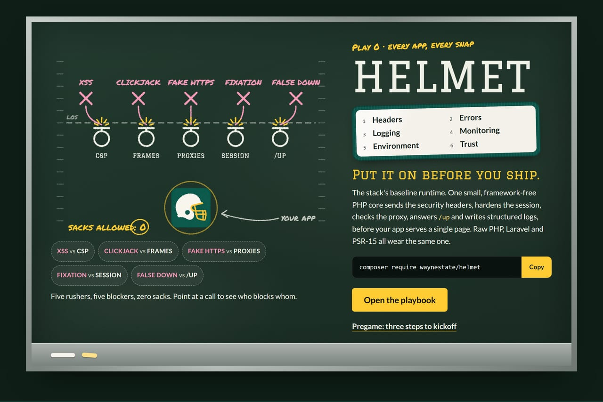
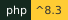
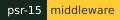

<div align="center">
  <a href="../index.html"></a>
</div>

# HELMET


<sub>GIF via [Tenor](https://tenor.com/view/helmet-band-wilmas-rainbow-helmet-band-music-gif-25658120)</sub>

<p>
  
  
  
  <a href="https://github.com/waynestate/helmet/actions/workflows/ci.yml"></a>
</p>

**Put it on before you ship.** Security headers, a hardened session and an honest proxy check, snapped on before
the first page is served.

HELMET is the Wayne State app stack's baseline runtime: one small framework-free PHP core that sends the security
headers, hardens the session, decides whether the request really arrived over HTTPS, answers the load balancer's
`/up` ping, and writes structured logs.

## Pick your path

- **New here?** The [Quick start](guides/quick-start.md) puts a raw PHP app behind the baseline in four steps.
- **Installing it now?** [Install](install.md) has the requirements, the Composer line and the verify step.
- **Looking for a setting or a function?** The Reference group starts with [Environment variables](reference/configuration.md),
  every `HELMET_` variable the package reads.

## Install

```
composer require waynestate/helmet
```

Then boot it once at the top of the front controller, before anything is echoed:

```php
use function Waynestate\Helmet\helmet_boot;

$helmet = helmet_boot([
    'preset' => 'citadel',
]);
```

`helmet_boot()` sends the headers, strips `X-Powered-By`, and answers `/up` with `200 ok` before your code runs.
It returns the nonce, the logger and the request ID so the rest of the app can use them.

Version 0.3.0, MIT licensed.

Agents: the machine-readable map of these docs lives at [https://helmet.apps.wayne.edu/llms.txt](https://helmet.apps.wayne.edu/llms.txt).

Milquetoast is a Helmet song. It is not a Content-Security-Policy.

## Environment variables

Generated from the code: every `HELMET_` variable the package reads, its meaning, its default, and the file that reads it.

<!-- generated:env -->
| Variable | Meaning | Default | Read in |
| --- | --- | --- | --- |
| HELMET_COOP | Value of the Cross-Origin-Opener-Policy header; an empty value sends no header. | same-origin | config/helmet.php |
| HELMET_CORP | Value of the Cross-Origin-Resource-Policy header; unset sends no header. | none | config/helmet.php |
| HELMET_CSP | JSON policy array merged over the default CSP per directive; empty or invalid JSON keeps the default. | the core default policy | config/helmet.php |
| HELMET_CSP_REPORT_ONLY | true sends the policy as Content-Security-Policy-Report-Only, observing violations without blocking them. | false | config/helmet.php |
| HELMET_CSP_REPORT_URI | URL browsers POST CSP violation reports to; adds report-uri and report-to to the policy plus a Reporting-Endpoints header. Must be https. | none | config/helmet.php |
| HELMET_CSP_TRUSTED_TYPES_ENABLED | true appends Trusted Types directives to the report-only CSP header. | false | config/helmet.php |
| HELMET_CSP_TRUSTED_TYPES_POLICIES | Comma-separated Trusted Types policy names; replaces the default list. | ["default"] | config/helmet.php |
| HELMET_CSRF_ALLOW_SAME_SITE | true lets Sec-Fetch-Site: same-site pass; off by default because sibling subdomains are still same-site. | false | config/helmet.php |
| HELMET_CSRF_ENABLED | true turns on the request-forgery guard for state-changing requests. | false | config/helmet.php |
| HELMET_CSRF_EXCEPT | Comma-separated path patterns that skip the guard: an exact path, a prefix ending in *, or * for every path. | none | config/helmet.php |
| HELMET_CSRF_TRUSTED_ORIGINS | Comma-separated origins allowed to make state-changing requests when the Origin fallback is used. | none | config/helmet.php |
| HELMET_DEV_ORIGIN | Vite dev server origin, used in local only while the dev server is running; must be http or https on localhost, 127.0.0.1 or [::1]. Overrides the hot file. | none | config/helmet.php |
| HELMET_HSTS_INCLUDE_SUBDOMAINS | false omits the HSTS includeSubDomains directive. | true | config/helmet.php |
| HELMET_HSTS_MAX_AGE | HSTS max-age in seconds, sent on HTTPS only; must not be negative. | 31536000 | config/helmet.php |
| HELMET_HSTS_PRELOAD | true appends preload to HSTS; requires a year of max-age and includeSubDomains, and is hard to undo. | false | config/helmet.php |
| HELMET_METRICS_ALLOW | Comma-separated IPs or CIDR ranges allowed to scrape /metrics without a token. | none | config/helmet.php |
| HELMET_METRICS_ENABLED | true exposes the /metrics endpoint; with neither a token nor an allow list it returns 404 and logs a warning. | false | config/helmet.php |
| HELMET_METRICS_TOKEN | Bearer token the scraper sends as Authorization: Bearer <token>; compared with hash_equals. | none | config/helmet.php |
| HELMET_NO_STORE_ENABLED | true sends Cache-Control: no-store on matching responses. | false | config/helmet.php |
| HELMET_NO_STORE_PATHS | Comma-separated path prefixes that carry no-store; empty means every response. | none | config/helmet.php |
| HELMET_PERMISSIONS_POLICY | JSON feature map for the Permissions-Policy header; the default is a deny list and an empty object sends no header. | the default deny list | config/helmet.php |
| HELMET_POLICY_PATH | Path to a CREED policy.json; the ribbon then shows a version warning for the running PHP (and, in Laravel, framework) version. A missing or invalid file never breaks the page. | none | config/helmet.php |
| HELMET_PRESET | Platform preset name (citadel or docker) that supplies the trusted proxies; read from the environment, else from Playbook. HELMET_PROXIES wins when both are set; an unknown name throws. | none | config/helmet.php |
| HELMET_PROXIES | Comma-separated IPs or CIDR ranges allowed to set X-Forwarded-Proto; wins over HELMET_PRESET and is copied to trustedproxy.proxies when the app has not set it. An explicitly empty value trusts nobody. | none | config/helmet.php |
| HELMET_RIBBON | false switches the maintenance ribbon off everywhere. | true | config/helmet.php |
| HELMET_SCOPE | global puts SecurityHeaders in the kernel's global middleware; web keeps it in the web group only. InjectRibbon always stays in web. | global | config/helmet.php |
| HELMET_SESSION_SECURE | auto sets the Secure flag only when the request is HTTPS; always forces it for apps whose TLS terminates in a proxy. Anything else throws. | auto | config/helmet.php |
| HELMET_WARN_DEBUG | true makes the Laravel adapter log one warning when the app boots with debug enabled in production. | true | config/helmet.php |
<!-- /generated -->
